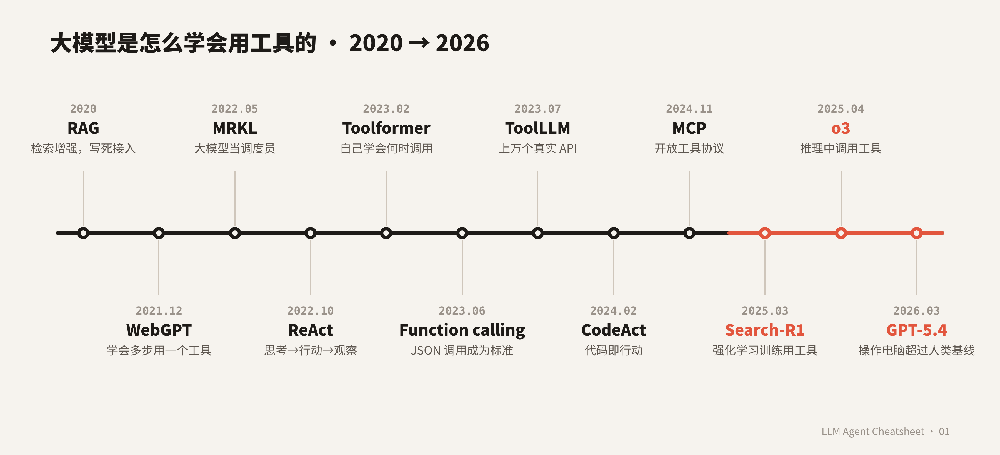

# LLM Agent 速查表 · 01：大模型是怎么学会用工具的（2015 → 2026）

[English](README.md) | **中文**

> 大多数 agent 论文清单只给链接。这一期讲的是一条故事线：每个阶段先说**当时卡在什么问题上**，再看**哪些论文解决了它**，最后看**这个解法又带来了什么新问题**。



📄 **4 页速查表（PDF）：** [cheatsheet_zh.pdf](cheatsheet_zh.pdf)——公式、调用格式、关键数字、自测题。

## 一句话总结

**检索增强（工具写死）→ 学会用一个工具（WebGPT）→ 多工具路由（MRKL）→ 边想边做（ReAct）→ 自己学会何时调用（Toolformer）→ 规模化到上万 API（ToolLLM）→ 标准接口（function calling、MCP）→ 自己造工具、用代码行动 → 用强化学习训练"边想边用工具"**

## 目录

| 阶段 | 年份 | 回答的问题 |
|---|---|---|
| [0. 前史](#阶段-0--前史模块与检索20152020) | 2015–2020 | 模型能不能用上权重之外的东西？ |
| [1. 一个工具](#阶段-1--学会用一个工具20212022) | 2021–2022 | 模型能不能多步操作一个工具？ |
| [2. 多个工具](#阶段-2--大模型当调度员2022) | 2022 | 怎么一次接上很多工具？ |
| [3. 代码当工具](#阶段-3--代码就是工具2022) | 2022 | 怎么不让模型心算出错？ |
| [4. 边想边做](#阶段-4--推理和行动交替2022) | 2022 | 工具调用应该怎么嵌进推理？ |
| [5. 自学调用](#阶段-5--自己学会什么时候调用2023) | 2023 | 不靠标注，模型能不能自己学会何时调用？ |
| [6. 模型当工具](#阶段-6--大模型指挥其他模型2023) | 2023 | 大模型能不能指挥其他 AI 模型？ |
| [7. 规模化](#阶段-7--上万个-api2023) | 2023 | 几千个 API 里怎么选？ |
| [8. 标准化](#阶段-8--产品化与标准化20232024) | 2023–2024 | 怎么把工具调用变成稳定的产品能力？ |
| [9. 自我检查](#阶段-9--用工具检查自己2023) | 2023 | 工具能不能帮模型发现自己的错误？ |
| [10. 自己造工具](#阶段-10--自己造工具2023) | 2023 | 合适的工具还不存在怎么办？ |
| [11. 代码即行动](#阶段-11--代码即行动为-agent-设计接口2024) | 2024 | JSON 是 agent 行动的最好方式吗？ |
| [12. 评测](#阶段-12--怎么衡量20232024) | 2023–2024 | 这些能力怎么衡量？ |
| [13. 安全](#阶段-13--工具带来新的攻击面20232024) | 2023–2024 | 工具返回不可信的文本时会出什么问题？ |
| [14. 2025–2026](#阶段-14--20252026强化学习与推理中调用工具) | 2025–2026 | 能不能直接训练模型"边想边用工具"？ |

---

## 阶段 0 · 前史：模块与检索（2015–2020）

**问题：** 语言模型只知道权重里存着的东西。

| 论文 | 首发 | 机构 | 做了什么 |
|---|---|---|---|
| [Neural Module Networks](https://arxiv.org/abs/1511.02799) | 2015-11 | UC Berkeley | 针对每个问题，把小的神经模块拼成一个网络来做视觉问答，是"模块化推理"的早期形态。 |
| [REALM](https://arxiv.org/abs/2002.08909) | 2020-02 | Google Research | 把语言模型和一个可学习的维基百科检索器一起预训练。 |
| [RAG](https://arxiv.org/abs/2005.11401) | 2020-05 | Facebook AI / UCL | 生成器加稠密文档索引，检索成了第一个被广泛使用的"工具"。 |

**变化：** 模型能查资料了。**还缺什么：** 检索器是写死的，模型从来不"决定"要不要用工具。

## 阶段 1 · 学会用一个工具（2021–2022）

**问题：** 模型能不能自己多步操作一个真实的工具？

| 论文 | 首发 | 机构 | 做了什么 |
|---|---|---|---|
| [WebGPT](https://arxiv.org/abs/2112.09332) | 2021-12 | OpenAI | 微调 GPT-3 使用纯文字浏览器（搜索、点击、翻页、摘录），写出带引用的答案。先模仿人类示范，再用奖励模型从 *n* 个答案里挑最好的。在 ELI5 上，它的答案有 56% 的时候比人类示范者更受偏好，69% 的时候比 Reddit 最高赞回答更受偏好。 |
| [LaMDA](https://arxiv.org/abs/2201.08239) | 2022-01 | Google | 对话模型学会调用一个"工具集"（检索系统、翻译、计算器）来让回答有依据。 |
| [少样本提示的联网语言模型](https://arxiv.org/abs/2203.05115) | 2022-03 | DeepMind | 不微调，只用少样本提示，让模型基于 Google 搜索结果回答。 |

**变化：** 模型能多步驱动一个工具。**代价：** 需要昂贵的人类示范，一次只学一个工具。

## 阶段 2 · 大模型当调度员（2022）

**问题：** 真正的助手需要很多工具（计算器、数据库、API），怎么全部接上？

| 论文 | 首发 | 机构 | 做了什么 |
|---|---|---|---|
| [MRKL Systems](https://arxiv.org/abs/2205.00445) | 2022-05 | AI21 Labs | 大模型当**路由器**，把每个请求分给神经网络或符号系统的专家模块。附带一个算术案例（Jurassic-X）。 |
| [TALM](https://arxiv.org/abs/2205.12255) | 2022-05 | Google | 文本到文本的工具接口，加上迭代的"自我对弈"，从少量示范开始扩充工具使用数据。 |

**变化：** "大模型 + 可插拔工具"成为一种系统设计，而不只是个例。

## 阶段 3 · 代码就是工具（2022）

**问题：** 即使推理思路对了，大模型也常常算错数。

| 论文 | 首发 | 机构 | 做了什么 |
|---|---|---|---|
| [PAL](https://arxiv.org/abs/2211.10435) | 2022-11 | CMU | 模型写 Python，由解释器算出答案。[代码](https://github.com/reasoning-machines/pal) |
| [Program of Thoughts](https://arxiv.org/abs/2211.12588) | 2022-11 | 滑铁卢大学 / Vector Institute | 把推理（写成程序）和计算（交给外部执行）分开。[代码](https://github.com/wenhuchen/Program-of-Thoughts) |

**变化：** 代码解释器成了最通用的工具。

## 阶段 4 · 推理和行动交替（2022）

**问题：** 之前的系统要么只推理、要么只调工具，真实问题需要两者交替进行。

| 论文 | 首发 | 机构 | 做了什么 |
|---|---|---|---|
| [ReAct](https://arxiv.org/abs/2210.03629) | 2022-10 | 普林斯顿 / Google | **思考 → 行动 → 观察** 循环：想一步、做一步、看结果再想。之后几乎所有 agent 框架都以它为基础。[代码](https://github.com/ysymyth/ReAct) |
| [Self-Ask](https://arxiv.org/abs/2210.03350)（论文题目：*Measuring and Narrowing the Compositionality Gap in Language Models*） | 2022-10 | 华盛顿大学 / MosaicML | 模型自己提出子问题交给搜索引擎回答，再组合起来。[代码](https://github.com/ofirpress/self-ask) |
| [IRCoT](https://arxiv.org/abs/2212.10509) | 2022-12 | 石溪大学 | 检索和思维链交替进行，每一步推理指导下一次搜索。[代码](https://github.com/stonybrooknlp/ircot) |

```
Thought:     我需要知道 X 出生城市的人口。
Action:      search("X 出生地")
Observation: X 出生在里昂。
Thought:     接下来查里昂的人口。
Action:      search("里昂 人口")
...
```

**变化：** 工具调用嵌进了推理过程，这就是现代 agent 的基本形态。

## 阶段 5 · 自己学会什么时候调用（2023）

**问题：** 标注"哪里该调用工具"很贵，模型能不能自己学？

| 论文 | 首发 | 机构 | 做了什么 |
|---|---|---|---|
| [Toolformer](https://arxiv.org/abs/2302.04761) | 2023-02 | Meta AI | 在普通文本里采样候选 API 调用，只有当插入"调用**加上返回结果**"能让后面文本的预测损失下降超过阈值时，才保留这个调用。工具包括计算器、问答系统、两个搜索引擎、翻译和日历；基座模型是 GPT-J（67 亿参数）。 |

**变化：** "什么时候该调用工具"可以用自监督的方式大规模学习。

## 阶段 6 · 大模型指挥其他模型（2023）

**问题：** 视觉、语音等专门模型已经有很多了，大模型能不能来统筹调度？

| 论文 | 首发 | 机构 | 做了什么 |
|---|---|---|---|
| [Visual ChatGPT](https://arxiv.org/abs/2303.04671) | 2023-03 | 微软亚洲研究院 | 把 ChatGPT 和视觉基础模型连起来，完成多步图像任务。[代码](https://github.com/microsoft/visual-chatgpt) |
| [ViperGPT](https://arxiv.org/abs/2303.08128) | 2023-03 | 哥伦比亚大学 | 代码模型写 Python 来组合视觉模块。[代码](https://github.com/cvlab-columbia/viper) |
| [HuggingGPT](https://arxiv.org/abs/2303.17580) | 2023-03 | 浙江大学 / 微软亚洲研究院 | 大模型做规划，挑选 Hugging Face 上的模型执行，再汇总结果。[代码](https://github.com/microsoft/JARVIS) |
| [Chameleon](https://arxiv.org/abs/2304.09842) | 2023-04 | UCLA | 大模型规划器把视觉、搜索、Python 等工具组合成程序。[代码](https://github.com/lupantech/chameleon-llm) |

**变化：** "工具"开始包括其他 AI 模型。

## 阶段 7 · 上万个 API（2023）

**问题：** 工具一多，难点变成了选对工具、填对参数、不编造参数。

| 论文 | 首发 | 机构 | 做了什么 |
|---|---|---|---|
| [API-Bank](https://arxiv.org/abs/2304.08244) | 2023-04 | 阿里达摩院 | 最早一批可运行的工具调用评测基准之一（73 个 API、314 段对话）。 |
| [Tool Learning with Foundation Models](https://arxiv.org/abs/2304.08354) | 2023-04 | 清华大学 | 工具学习的综述和通用框架。 |
| [Gorilla](https://arxiv.org/abs/2305.15334) | 2023-05 | UC Berkeley | 在 API 文档上用**结合检索器的训练**（retriever-aware training）微调 LLaMA-7B，并提出 APIBench。[代码](https://github.com/ShishirPatil/gorilla) |
| [ToolLLM](https://arxiv.org/abs/2307.16789) | 2023-07 | 清华大学 | ToolBench 数据集：**16,464 个真实 RapidAPI 接口**，覆盖 49 个类别，并用深度优先树搜索（DFSDT）寻找解题路径。[代码](https://github.com/OpenBMB/ToolBench) |

**变化：** 工具检索和参数准确性本身成了研究问题。

## 阶段 8 · 产品化与标准化（2023–2024）

**问题：** 每个系统都有自己一套临时的调用格式。

| 发布 | 日期 | 机构 | 做了什么 |
|---|---|---|---|
| [ChatGPT 插件](https://openai.com/index/chatgpt-plugins/) | 2023-03 | OpenAI | 在 ChatGPT 里接入浏览、代码解释器和第三方插件。 |
| [Function calling](https://openai.com/index/function-calling-and-other-api-updates/) | 2023-06 | OpenAI | 开发者用 JSON Schema 描述函数，模型返回结构化的 JSON 参数，成为行业默认接口。 |
| [Model Context Protocol（MCP）](https://www.anthropic.com/news/model-context-protocol) | 2024-11 | Anthropic | 连接模型与工具、数据源的开放协议，附带规范、SDK 和参考实现。[规范](https://modelcontextprotocol.io) |

**变化：** 工具调用从研究技巧变成了模型的标准能力。

## 阶段 9 · 用工具检查自己（2023）

**问题：** agent 会失败，而且会重复同样的错误。

| 论文 | 首发 | 机构 | 做了什么 |
|---|---|---|---|
| [Reflexion](https://arxiv.org/abs/2303.11366) | 2023-03 | 东北大学（美国） | 失败后把文字形式的反思写进记忆再重试，不需要更新模型参数。[代码](https://github.com/noahshinn/reflexion) |
| [CRITIC](https://arxiv.org/abs/2305.11738) | 2023-05 | 清华大学 / 微软亚洲研究院 | 用搜索、代码执行等工具验证并修改自己的输出。 |
| [Language Agent Tree Search](https://arxiv.org/abs/2310.04406) | 2023-10 | UIUC | 把蒙特卡洛树搜索和 ReAct 式的行动、自我反思结合起来。[代码](https://github.com/lapisrocks/LanguageAgentTreeSearch) |

**变化：** 工具不只用来"做事"，也用来"检查"。

## 阶段 10 · 自己造工具（2023）

**问题：** 有时候合适的工具根本不存在。

| 论文 | 首发 | 机构 | 做了什么 |
|---|---|---|---|
| [LATM：大模型当工具制造者](https://arxiv.org/abs/2305.17126) | 2023-05 | 普林斯顿 / Google DeepMind | 强模型写可复用的 Python 工具，便宜的模型反复使用。[代码](https://github.com/ctlllll/LLM-ToolMaker) |
| [CREATOR](https://arxiv.org/abs/2305.14318) | 2023-05 | 清华大学 | 模型先用代码造一个工具，再执行它来解题。[代码](https://github.com/qiancheng0/CREATOR) |
| [Voyager](https://arxiv.org/abs/2305.16291) | 2023-05 | NVIDIA / 加州理工 | 《我的世界》里的 agent，把能用的代码存进不断增长的**技能库**。[代码](https://github.com/MineDojo/Voyager) |

**变化：** agent 开始随时间积累能力，这是"自我进化"agent 的萌芽。

## 阶段 11 · 代码即行动、为 agent 设计接口（2024）

**问题：** JSON 调用很死板，一次只能做一件事。

| 论文 | 首发 | 机构 | 做了什么 |
|---|---|---|---|
| [CodeAct（Executable Code Actions Elicit Better LLM Agents）](https://arxiv.org/abs/2402.01030) | 2024-02 | UIUC | 把可执行的 Python 代码作为 agent 的行动空间；在 17 个模型上比 JSON/文本行动成功率最多高 20%。[代码](https://github.com/xingyaoww/code-act) |
| [SWE-agent](https://arxiv.org/abs/2405.15793) | 2024-05 | 普林斯顿 | 设计了**agent-计算机接口（ACI）**，专门为 agent 浏览和修改代码仓库设计的命令。[代码](https://github.com/SWE-agent/SWE-agent) |

**变化：** 重心从"模型怎么调用工具"转向"**工具该怎么为模型设计**"。

## 阶段 12 · 怎么衡量？（2023–2024）

| 基准 | 首发 | 机构 | 测什么 |
|---|---|---|---|
| [WebArena](https://arxiv.org/abs/2307.13854) | 2023-07 | CMU | 自建的真实网站环境；最好的 GPT-4 agent 成功率 14.41%，人类 78.24%。 |
| [AgentBench](https://arxiv.org/abs/2308.03688) | 2023-08 | 清华大学 | 在 8 个环境里评测大模型当 agent 的能力。 |
| [GAIA](https://arxiv.org/abs/2311.12983) | 2023-11 | Meta / Hugging Face | 466 个真实助手类问题；人类 92%，带插件的 GPT-4 只有 15%。 |
| [Berkeley Function Calling Leaderboard](https://gorilla.cs.berkeley.edu/leaderboard.html) | 2024-02 | UC Berkeley | 通过语法树匹配和实际执行评测函数调用准确性，后续版本加入多轮和 agent 场景。 |
| [τ-bench](https://arxiv.org/abs/2406.12045) | 2024-06 | Sierra | 工具 agent + 模拟用户 + 业务规则，提出衡量稳定性的 pass^k 指标。[代码](https://github.com/sierra-research/tau-bench) |

## 阶段 13 · 工具带来新的攻击面（2023–2024）

**问题：** 工具返回的网页、邮件、文件都是不可信的文本，模型却可能把它们当成指令。

| 论文 | 首发 | 机构 | 做了什么 |
|---|---|---|---|
| [间接提示注入（Not what you've signed up for）](https://arxiv.org/abs/2302.12173) | 2023-02 | 萨尔大学 / sequire | 证明藏在检索内容里的指令可以劫持接入大模型的应用。 |
| [InjecAgent](https://arxiv.org/abs/2403.02691) | 2024-03 | UIUC | 针对工具型 agent 的 1,054 个间接注入测试用例。[代码](https://github.com/uiuc-kang-lab/InjecAgent) |
| [AgentDojo](https://arxiv.org/abs/2406.13352) | 2024-06 | 苏黎世联邦理工 | 可扩展的注入攻击与防御评测环境（97 个任务、629 个安全测试）。[代码](https://github.com/ethz-spylab/agentdojo) |

**变化：** agent 能做的事越多，攻击者能让它做的事也越多。

## 阶段 14 · 2025–2026：强化学习与推理中调用工具

**问题：** 靠提示和模仿能走的路有限。能不能用奖励直接**训练**模型，让它在推理过程中自己决定什么时候、怎么调用工具？

### 14a. 用强化学习训练工具使用（"agentic RL"）

| 论文 | 首发 | 机构 | 做了什么 |
|---|---|---|---|
| [R1-Searcher](https://arxiv.org/abs/2503.05592) | 2025-03 | 中国人民大学 | 两阶段强化学习，只用最终结果作奖励，教模型在推理中调用搜索引擎。 |
| [Search-R1](https://arxiv.org/abs/2503.09516) | 2025-03 | UIUC / UMass Amherst / Google Cloud | 用简单的结果奖励做强化学习，让模型在逐步推理中穿插多次搜索。 |
| [ToRL](https://arxiv.org/abs/2503.23383) | 2025-03 | 上海交大 / GAIR | 直接从基座模型出发、配合代码解释器做强化学习；7B 模型在 AIME24 上达到 43.3%。 |
| [ReTool](https://arxiv.org/abs/2504.11536) | 2025-04 | 字节跳动 Seed | 长推理中穿插实时代码执行；32B 模型训练 400 步后 AIME 达到 67%，纯文本强化学习只有 40%。 |
| [ToolRL](https://arxiv.org/abs/2504.13958) | 2025-04 | UIUC | 第一个系统研究"工具选择和使用的奖励该怎么设计"的工作。 |
| [ARPO（Agentic Reinforced Policy Optimization）](https://arxiv.org/abs/2507.19849) | 2025-07 | 中国人民大学等 | 在每次工具调用之后、模型最不确定的那一步多采样分支；只用约一半的工具调用就能达到基线效果。 |
| [The Landscape of Agentic RL for LLMs](https://arxiv.org/abs/2509.02547) | 2025-09 | 多机构 | 把"agentic RL"定义为一个研究领域的综述。 |
| [ToolVerse](https://arxiv.org/abs/2607.15660) | 2026-07 | — | 从几百个真实 MCP 服务器自动搭建强化学习环境，并用工具依赖图生成长程任务。 |

### 14b. 推理模型在思考中调用工具

| 发布 | 日期 | 机构 | 变化 |
|---|---|---|---|
| [OpenAI deep research](https://openai.com/index/introducing-deep-research/) | 2025-02 | OpenAI | 用强化学习在浏览和 Python 任务上端到端训练的 o3 版本，能写带引用的研究报告。 |
| [o3 和 o4-mini](https://openai.com/index/introducing-o3-and-o4-mini/) | 2025-04 | OpenAI | 推理模型在思维链中自主使用并组合 ChatGPT 里的所有工具（搜索、Python、图像）。 |
| [Claude 4](https://www.anthropic.com/news/claude-4) | 2025-05 | Anthropic | 支持带工具的扩展思考，以及在工具调用之间穿插思考（interleaved thinking）。 |
| [通义 DeepResearch](https://arxiv.org/abs/2510.24701) | 2025-10 | 阿里通义实验室 | 开源的 305 亿参数 MoE 模型（激活 33 亿），专做长程网络调研。 |
| [DeepSeek-V3.2](https://api-docs.deepseek.com/news/news251201) | 2025-12 | DeepSeek | 把思考直接融入工具使用；在 1,800 多个环境中合成 agent 训练数据。 |

### 14c. 接口层走向标准化

| 发布 | 日期 | 机构 | 变化 |
|---|---|---|---|
| [Agent2Agent（A2A）](https://developers.googleblog.com/en/a2a-a-new-era-of-agent-interoperability/) | 2025-04 | Google | agent 之间互相通信的开放协议，定位为 MCP 的补充；2025-06 移交 Linux 基金会。 |
| [Responses API 支持远程 MCP](https://openai.com/index/new-tools-and-features-in-the-responses-api/) | 2025-05 | OpenAI | OpenAI 采用 MCP，并加入 MCP 指导委员会。 |
| [Agent Skills](https://claude.com/resources/articles/skills) | 2025-10 | Anthropic | 由说明、脚本和资源组成的文件夹，只在相关时才加载；2025-12 发布为开放标准。 |
| [Agentic AI Foundation](https://www.anthropic.com/news/donating-the-model-context-protocol-and-establishing-of-the-agentic-ai-foundation) | 2025-12 | Anthropic、OpenAI、Block / Linux 基金会 | MCP 移交中立机构治理；当时已有 1 万多个公开服务器，ChatGPT、Gemini、Copilot、VS Code、Cursor 都已支持。 |
| [MCP Apps](https://blog.modelcontextprotocol.io/posts/2026-01-26-mcp-apps/) | 2026-01 | MCP 项目 | 第一个官方扩展：工具可以返回可交互的界面。 |
| [MCP 2026-07-28 规范](https://modelcontextprotocol.io/specification/2026-07-28/changelog) | 2026-07 | MCP 项目 | 改成无状态设计，去掉会话和初始化握手。 |

### 14d. 工具太多：上下文成了瓶颈

| 发布 | 日期 | 机构 | 变化 |
|---|---|---|---|
| [Code execution with MCP](https://www.anthropic.com/engineering/code-execution-with-mcp) | 2025-11 | Anthropic | agent 通过写代码调用 MCP 工具，不用把所有工具定义都塞进上下文；一个例子从约 15 万 token 降到 2 千。相当于 CodeAct 思路的工程化。 |
| [Advanced tool use](https://www.anthropic.com/engineering/advanced-tool-use) | 2025-11 | Anthropic | 按需加载工具定义的"工具搜索"，以及用程序调用工具。 |
| [GPT-5.4](https://openai.com/index/introducing-gpt-5-4/) | 2026-03 | OpenAI | 按需工具搜索（在 36 个 MCP 服务器上，准确率不变的情况下少用 47% 的 token），并原生支持操作电脑。 |

### 14e. 操作电脑的 agent 追上人类

| 发布 | 日期 | 机构 | OSWorld |
|---|---|---|---|
| [Computer-Using Agent（Operator）](https://openai.com/index/computer-using-agent/) | 2025-01 | OpenAI | 38.1%（人类 72.4%） |
| [Claude Sonnet 4.5](https://www.anthropic.com/news/claude-sonnet-4-5) | 2025-09 | Anthropic | 61.4% |
| [GPT-5.4](https://openai.com/index/introducing-gpt-5-4/) | 2026-03 | OpenAI | OSWorld-Verified 75.0%，超过人类基线 72.4% |

### 14f. 新的评测基准

| 基准 | 首发 | 机构 | 测什么 |
|---|---|---|---|
| [BrowseComp](https://arxiv.org/abs/2504.12516) | 2025-04 | OpenAI | 1,266 个难找但容易核对的问题，考验持续浏览网页的能力。 |
| [τ²-bench](https://arxiv.org/abs/2506.07982) | 2025-06 | Sierra 等 | 用户也能操作环境，agent 还得指导用户一起完成任务。 |
| [MCP-Universe](https://arxiv.org/abs/2508.14704) | 2025-08 | Salesforce AI Research | 11 个真实 MCP 服务器；发布时最好的模型只有 43.7%。 |
| [Toolathlon](https://arxiv.org/abs/2510.25726) | 2025-10 | 多机构 | 32 个应用、604 个工具、108 个长程任务；发布时最好成绩 38.6%。 |
| [Terminal-Bench](https://arxiv.org/abs/2601.11868) | 2026-01 | Stanford / Laude 等 | 89 个困难的命令行任务，每个都有独立容器。 |

### 14g. 安全问题更难了

| 工作 | 日期 | 机构 | 发现 |
|---|---|---|---|
| [CaMeL：从设计上防御提示注入](https://arxiv.org/abs/2503.18813) | 2025-03 | Google / Google DeepMind / 苏黎世联邦理工 | 把控制流和数据流分开；在可证明安全的前提下完成 AgentDojo 77% 的任务。 |
| [MCP 工具投毒](https://invariantlabs.ai/blog/mcp-security-notification-tool-poisoning-attacks) | 2025-04 | Invariant Labs | 在工具描述里藏恶意指令，或者在用户批准后偷偷修改描述。 |
| [Design Patterns for Securing LLM Agents](https://arxiv.org/abs/2506.08837) | 2025-06 | 苏黎世联邦理工 / IBM / Google / 微软等 | 整理了一批可证明抗注入的架构模式，以及各自牺牲的能力。 |
| [The Attacker Moves Second](https://arxiv.org/abs/2510.09023) | 2025-10 | OpenAI、Anthropic、Google DeepMind、苏黎世联邦理工等 | 自适应攻击攻破了 12 个已发表的防御方法，大多数成功率超过 90%。 |
| [ClawHub 恶意技能事件](https://unit42.paloaltonetworks.com/openclaw-ai-supply-chain-risk/) | 2026-02 | Palo Alto Unit 42 等 | agent 技能市场里出现几百个恶意"技能"，供应链攻击蔓延到 agent。 |

**变化：** 工具使用变成了模型在推理过程中、通过统一协议、被奖励**训练**出来的能力。仍然没解决的问题是：成本（上下文里工具太多）、长程任务的稳定性，以及安全。

---

## 入门必读 6 篇

只读六篇的话，按这个顺序：

1. [WebGPT](https://arxiv.org/abs/2112.09332)：第一个完整的多步工具使用演示。
2. [ReAct](https://arxiv.org/abs/2210.03629)：思考 → 行动 → 观察的循环。
3. [Toolformer](https://arxiv.org/abs/2302.04761)：不靠标注，自己学会什么时候调用工具。
4. [ToolLLM](https://arxiv.org/abs/2307.16789)：工具规模到上万个时，问题变成了什么。
5. [Executable Code Actions（CodeAct）](https://arxiv.org/abs/2402.01030)：为什么代码比 JSON 更适合做 agent 的行动。
6. [Search-R1](https://arxiv.org/abs/2503.09516)：用强化学习训练工具使用。

## 延伸阅读

- [Tool Learning with Foundation Models](https://arxiv.org/abs/2304.08354)（综述，2023）
- [The Landscape of Agentic Reinforcement Learning for LLMs](https://arxiv.org/abs/2509.02547)（综述，2025）
- [Agentic Tool Use in Large Language Models](https://arxiv.org/abs/2604.00835)（综述，2026）：把这个领域分成提示 → 监督式工具学习 → 奖励驱动的工具策略三个阶段。

## 说明

- **日期**是首次公开的月份：论文用 arXiv v1，产品用官方发布日期。部分论文在 v1 之后改过标题，链接指向当前版本。
- 内容于 **2026 年 10 月**对照 arXiv 和官方来源核对过。这个领域变化很快，如果发现错误或者遗漏的里程碑，欢迎提 issue 或 pull request。
- 机构一栏是第一作者的主要单位（简称）。

## 许可

正文采用 [CC BY 4.0](https://creativecommons.org/licenses/by/4.0/deed.zh-hans)，注明出处即可自由转载和改编。

