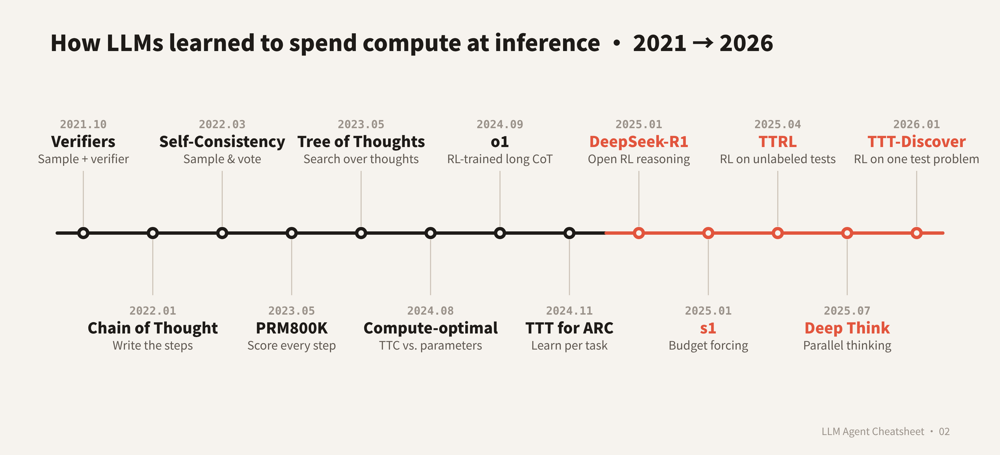

# LLM Agent Cheatsheet · 02: The Evolution of Test-Time Scaling (2019 → 2026)

**English** | [中文](README_zh.md)

> Can a trained model get smarter by spending more compute at inference time? This episode goes from "sample a few and pick one" to "learn at inference time". Each stage starts with **the problem people were stuck on**, then **the papers that solved it**, then **the new problem the solution created**.

📄 **4-page cheatsheet (PDF, Chinese):** [cheatsheet_zh.pdf](cheatsheet_zh.pdf): formulas, algorithms, key numbers, self-test questions.

## TL;DR

**Sample + verifier → chain of thought (write more steps) → self-consistency (vote) → process rewards (score every step) → tree search and self-revision → scaling laws for inference compute → RL trains long thinking into the model (o1, R1) → controlling thinking length → thinking in latent space → test-time training (update weights at inference) → adaptive thinking and parallel thinking**

## First: where can inference compute go?

| Axis | How compute is spent | Examples | What it needs |
|---|---|---|---|
| **Parallel** | Sample N independently, then aggregate | Best-of-N, self-consistency, parallel thinking (Deep Think) | An aggregator: voting, a verifier, confidence |
| **Sequential** | One longer chain, or repeated revision | Chain of thought, Self-Refine, o1 / R1 long thinking, s1's "Wait" | A model that can correct itself |
| **Search** | Expand, score and prune intermediate steps | Tree of Thoughts, PRM-guided beam search, MCTS | A verifier for intermediate steps |
| **Latent** | Loop more layers, no extra tokens | Coconut, Recurrent Depth | A purpose-built architecture |
| **Weight updates** | Train on the test sample | TTT, TTT for ARC, TTRL | A self-supervised signal or pseudo-labels |

Stages 1–6 are mostly methods wrapped *around* the model; from stage 7 on, these abilities are increasingly **trained into the model itself**.

## Contents

| Stage | Years | Question it answers |
|---|---|---|
| [0. Prehistory](#stage-0--prehistory-trading-search-for-compute-20192021) | 2019–2021 | Can extra inference compute buy better results? |
| [1. Sample + verify](#stage-1--sample-many-pick-one-20212022) | 2021–2022 | Among many samples, how do we pick the right one? |
| [2. Chain of thought](#stage-2--let-the-model-write-more-steps-2022) | 2022 | Can the model write intermediate steps first? |
| [3. Self-consistency](#stage-3--self-consistency-sample-many-chains-and-vote-20222024) | 2022–2024 | Without a verifier, how do we use many samples? |
| [4. Process rewards](#stage-4--process-rewards-score-every-step-20222024) | 2022–2024 | How do we find which step went wrong? |
| [5. Search & revision](#stage-5--tree-search-and-self-revision-2023) | 2023 | Can we explore, backtrack and revise while generating? |
| [6. Scaling laws](#stage-6--scaling-laws-for-inference-compute-2024) | 2024 | What is inference compute worth vs parameters? |
| [7. Long-CoT RL](#stage-7--training-search-into-the-model-long-chains-of-thought-2024-09--2025-01) | 2024–2025 | Can we train the model to think longer and better? |
| [8. Length control](#stage-8--controlling-thinking-length-budgets-overthinking-and-underthinking-2024-12--2025) | 2024–2025 | How do we control how long it thinks? |
| [9. Latent space](#stage-9--thinking-in-latent-space-2024-12--2025) | 2024–2025 | Must thinking be written as text? |
| [10. Test-time training](#stage-10--test-time-training-updating-weights-at-inference-2019--2025) | 2019–2025 | Can the model learn from this problem at inference? |
| [11. 2025–2026](#stage-11--20252026-thinking-becomes-a-product-knob-parallel-thinking-the-premium-tier) | 2025–2026 | Thinking becomes a product knob; parallel thinking the premium tier |
| [12. Limits & debates](#stage-12--limits-and-debates-20252026) | 2025–2026 | Is thinking more always better? |

---

## Stage 0 · Prehistory: trading search for compute (2019–2021)

**Problem:** A trained model is fixed. Can spending more compute at inference time buy better results?

| Paper | First release | Org | What it did |
|---|---|---|---|
| [Scaling Scaling Laws with Board Games](https://arxiv.org/abs/2104.03113) | 2021-04 | Independent (Andy L. Jones) | Measured, for AlphaZero on Hex, how train-time compute trades against test-time search: **for each extra 10× of train compute, about 15× of test-time compute can be eliminated**. One of the first clean statements that inference compute has its own scaling law. |

**What changed:** In games, test-time search and a bigger model are substitutes. **What was missing:** Language models have no built-in search tree and no reliable scoring function.

## Stage 1 · Sample many, pick one (2021–2022)

**Problem:** One generation is often wrong. If we sample many answers, how do we pick the right one?

| Paper | First release | Org | What it did |
|---|---|---|---|
| [Training Verifiers to Solve Math Word Problems](https://arxiv.org/abs/2110.14168) | 2021-10 | OpenAI | Released GSM8K (8.5K grade-school math problems). Trained a **verifier** to score solutions, sampled 100 per problem and kept the top one. **A 6B model with a verifier slightly beat a fine-tuned 175B model**, about the same boost as a 30× larger model. |
| [AlphaCode](https://arxiv.org/abs/2203.07814) | 2022-02 | DeepMind | Sampled up to **millions** of programs per contest problem, filtered out ~99% using the example tests, clustered by behavior, and submitted at most 10. Ranked in the top 54.3% in Codeforces contests with 5,000+ participants. |

**What changed:** Best-of-N with a verifier became the basic test-time scaling recipe. **Cost:** A separately trained verifier and very many samples.

## Stage 2 · Let the model write more steps (2022)

**Problem:** Answering directly is hard. Can the model write out the intermediate steps first?

| Paper | First release | Org | What it did |
|---|---|---|---|
| [Chain-of-Thought Prompting](https://arxiv.org/abs/2201.11903) | 2022-01 | Google Research | Few-shot examples that show the reasoning. PaLM 540B on GSM8K: 17.9% → **56.9%**. |
| [Large Language Models are Zero-Shot Reasoners](https://arxiv.org/abs/2205.11916) | 2022-05 | University of Tokyo | Just add "Let's think step by step". MultiArith 17.7% → 78.7%, GSM8K 10.4% → 40.7% (text-davinci-002). |

**What changed:** More generated tokens = more inference compute. This is where the *sequential* direction starts. **What was missing:** If the single chain goes wrong, everything is wrong.

## Stage 3 · Self-consistency: sample many chains and vote (2022–2024)

**Problem:** One chain of thought is unreliable. What can we do without a verifier?

| Paper | First release | Org | What it did |
|---|---|---|---|
| [Self-Consistency](https://arxiv.org/abs/2203.11171) | 2022-03 | Google Research | Sample many reasoning paths (40 in the paper) and take a **majority vote on the final answer**. No training. GSM8K +17.9%, SVAMP +11.0%, AQuA +12.2%, StrategyQA +6.4%, ARC-c +3.9%. |
| [Universal Self-Consistency](https://arxiv.org/abs/2311.17311) | 2023-11 | Google | When answers cannot be matched exactly (summaries, open QA), concatenate the candidates and let the model pick the most consistent one. |
| [Are More LLM Calls All You Need?](https://arxiv.org/abs/2403.02419) | 2024-03 | Stanford | Voting accuracy can **rise and then fall** with the number of calls: more samples help easy queries and hurt hard ones. |

**What changed:** Self-consistency is the simplest *parallel* test-time scaling: N× compute for accuracy, no verifier needed. **What was missing:** Voting only sees final answers, cannot tell which step went wrong, and saturates.

## Stage 4 · Process rewards: score every step (2022–2024)

**Problem:** A correct answer can come from wrong reasoning, and neither voting nor outcome rewards notice.

| Paper | First release | Org | What it did |
|---|---|---|---|
| [Process- and Outcome-based Feedback](https://arxiv.org/abs/2211.14275) | 2022-11 | DeepMind | Compared outcome vs step-level supervision on GSM8K. Final-answer error was similar, but among correct-answer solutions **reasoning errors fell from 14.0% to 3.4%**. |
| [Let's Verify Step by Step](https://arxiv.org/abs/2305.20050) | 2023-05 | OpenAI | Collected **800K human step-level labels (PRM800K)** to train a process reward model (PRM). Picking from 1,860 candidates, it solved **78.2%** of a MATH subset, vs 72.4% for an outcome reward model and 69.6% for majority voting. |
| [Math-Shepherd](https://arxiv.org/abs/2312.08935) | 2023-12 | Peking University | No human labels: from each step, sample 8 completions and check whether they reach the right answer, giving **automatic step labels**. |
| [Rewarding Progress (PAV)](https://arxiv.org/abs/2410.08146) | 2024-10 | CMU / Google Research | Defines a step's value as its **progress**: the change in the probability of eventually being correct. >8% more accurate and 1.5–5× more compute-efficient than outcome reward models. |

**What changed:** With a verifier that scores intermediate steps, we can **search** during reasoning. **Cost:** Human labels are expensive, and PRMs can be gamed.

## Stage 5 · Tree search and self-revision (2023)

**Problem:** Voting and best-of-N pick after generation. Can we explore, backtrack and revise while generating?

| Paper | First release | Org | What it did |
|---|---|---|---|
| [Self-Refine](https://arxiv.org/abs/2303.17651) | 2023-03 | CMU | One model alternates between generating, critiquing itself and revising, with no training. About 20% absolute improvement on average over 7 tasks. |
| [Tree of Thoughts](https://arxiv.org/abs/2305.10601) | 2023-05 | Princeton / Google DeepMind | Splits reasoning into "thought" nodes that the model evaluates itself, searched with BFS / DFS and backtracking. Game of 24: GPT-4 + CoT 4%, ToT **74%**. |
| [RAP](https://arxiv.org/abs/2305.14992) | 2023-05 | UC San Diego | One LLM acts as both agent and **world model**, searched with **MCTS**. On Blocksworld planning, LLaMA-33B beats GPT-4 + CoT by 33% relative. |
| [Graph of Thoughts](https://arxiv.org/abs/2308.09687) | 2023-08 | ETH Zurich | Thoughts can merge and loop, forming a graph. On sorting, 62% better quality than ToT at >31% lower cost. |

**What changed:** Inference can now include **search** and **sequential revision**. **Cost:** Many model calls per problem; models evaluating themselves are often unreliable.

## Stage 6 · Scaling laws for inference compute (2024)

**Problem:** How much is extra inference compute worth? Should it go to inference, or to training a bigger model?

| Paper | First release | Org | What it did |
|---|---|---|---|
| [Large Language Monkeys](https://arxiv.org/abs/2407.21787) | 2024-07 | Stanford / Oxford | Coverage (at least one correct among N samples) grows **roughly log-linearly** over four orders of magnitude. SWE-bench Lite: DeepSeek-Coder-V2 goes from 15.9% (1 sample) to **56%** (250 samples), vs a 43% single-sample state of the art. But majority voting and reward models **plateau** after a few hundred samples. |
| [Scaling LLM Test-Time Compute Optimally](https://arxiv.org/abs/2408.03314) | 2024-08 | UC Berkeley / Google DeepMind | Two ways to spend inference compute: **search against a PRM**, and **let the model revise its answer step by step**. Choosing the strategy per difficulty ("compute-optimal") is **>4× more efficient** than best-of-N. At matched FLOPs, a small model plus test-time compute can beat a **14× larger** model, but only on problems where the small model already has some success; on the hardest problems, more pretraining is better. |
| [Inference Scaling Laws](https://arxiv.org/abs/2408.00724) | 2024-08 | Tsinghua / CMU | Shows weighted majority voting saturates as samples grow; the REBASE tree search lets Llemma-7B beat Llemma-34B with about half the compute. |
| [Generative Verifiers (GenRM)](https://arxiv.org/abs/2408.15240) | 2024-08 | Google DeepMind / Toronto | Verification as generation: the verifier writes a rationale, and the score is the probability of "Yes"; averaging over several rationales scales verification itself. GSM8K best-of-N 73% → 93.4%. |

**What changed:** Test-time compute was treated, for the first time, as a resource that **trades against parameters**, with clear scaling curves. **What was missing:** These methods sit *outside* the model; the model itself does not think better.

## Stage 7 · Training search into the model: long chains of thought (2024-09 → 2025-01)

**Problem:** Can we train the model itself to think longer and better, instead of wrapping search around it?

| Paper / Release | First release | Org | What it did |
|---|---|---|---|
| [Learning to Reason with LLMs (o1)](https://openai.com/index/learning-to-reason-with-llms/) | 2024-09 | OpenAI | Large-scale RL trains the model to produce long internal chains of thought. Performance improves **with both train-time (RL) and test-time (thinking) compute**. AIME 2024: GPT-4o 12%; o1 74% single sample, 83% with 64-way consensus, 93% when re-ranking 1,000 samples with a learned scorer. |
| [DeepSeek-R1](https://arxiv.org/abs/2501.12948) | 2025-01 | DeepSeek | **R1-Zero** uses only rule-based rewards and GRPO (no SFT): AIME 2024 goes from 15.6% to 71.0% (86.7% with majority voting), self-reflection emerges (the "**aha moment**"), and responses grow longer. R1 reaches 79.8%. Open weights and distilled small models. |
| [Kimi k1.5](https://arxiv.org/abs/2501.12599) | 2025-01 | Moonshot AI | RL with a 128k context, without MCTS, a value function or a PRM. AIME 77.5%. Introduces **long2short**: transfer long-thinking ability to short answers. |

**What changed:** Test-time scaling moved from an external algorithm to **an ability of the model itself**: longer thinking gives better answers, and RL can train this in. **New problems:** thinking too much, thinking too little, and how to control length.

## Stage 8 · Controlling thinking length: budgets, overthinking and underthinking (2024-12 → 2025)

**Problem:** Long chains are expensive; easy problems get long thoughts, while hard ones get abandoned too early.

| Paper / Release | First release | Org | What it did |
|---|---|---|---|
| [Do NOT Think That Much for 2+3=?](https://arxiv.org/abs/2412.21187) | 2024-12 | Tencent AI Lab / SJTU | Studies **overthinking**: on "2+3", o1-like models use 1,953% more tokens than conventional models. Their training fix cuts QwQ-32B's tokens on MATH500 by ~48.6% with almost no accuracy loss. |
| [Thoughts Are All Over the Place](https://arxiv.org/abs/2501.18585) | 2025-01 | Tencent AI Lab | Studies **underthinking**: wrong answers switch thoughts 418% more often than correct ones. TIP decoding penalizes premature switching. |
| [s1: Simple Test-Time Scaling](https://arxiv.org/abs/2501.19393) | 2025-01 | Stanford | Fine-tunes Qwen2.5-32B-Instruct on just **1,000** curated examples (26 minutes on 16 H100s). **Budget forcing**: append "Wait" when the model tries to stop, or cut it off at the budget. AIME24 50.0% → 56.7%; up to 27% above o1-preview on competition math. |
| [L1 (LCPO)](https://arxiv.org/abs/2503.04697) | 2025-03 | CMU | RL trains the model to **follow a thinking length given in the prompt**; at equal length, a 1.5B model beats GPT-4o. |

**What changed:** Thinking length became **a knob** (the "thinking budget" and "reasoning effort" in products). **What was missing:** All thinking is written as tokens, which is long and slow.

## Stage 9 · Thinking in latent space (2024-12 → 2025)

**Problem:** Does every reasoning step have to be written as text?

| Paper | First release | Org | What it did |
|---|---|---|---|
| [Coconut](https://arxiv.org/abs/2412.06769) | 2024-12 | Meta FAIR | Feeds the last hidden state back as the next input, reasoning in **continuous space** and keeping several candidate paths at once (BFS-like). ProsQA, which needs planning and backtracking: 97.0% vs CoT 77.5%; on GSM8K it is worse than CoT (34.1% vs 42.9%). |
| [Recurrent Depth](https://arxiv.org/abs/2502.05171) | 2025-02 | ELLIS / MPI Tübingen | A 3.5B model whose middle block can **loop any number of times**. More loops at inference means more compute (up to the equivalent of a 50B-parameter model) without emitting more tokens. |

**What changed:** Inference compute can be spent on **depth**, not just tokens. **Cost:** The reasoning is not readable, so it is harder to inspect and supervise.

## Stage 10 · Test-time training: updating weights at inference (2019 → 2025)

**Problem:** None of the above changes the weights. For an out-of-distribution problem, can the model **learn from that problem** at inference time?

| Paper | First release | Org | What it did |
|---|---|---|---|
| [Test-Time Training (TTT)](https://arxiv.org/abs/1909.13231) | 2019-09 | UC Berkeley | Under distribution shift, update a shared encoder on each test sample with a **self-supervised task (predicting image rotation)** before predicting. Large gains on ImageNet-C. |
| [TENT](https://arxiv.org/abs/2006.10726) | 2020-06 | UC Berkeley | **Minimize prediction entropy** at test time, updating only BatchNorm statistics and affine parameters. ImageNet-C error 59.5% → 44.0%. |
| [TTT Layers](https://arxiv.org/abs/2407.04620) | 2024-07 | Stanford | Makes an RNN's hidden state a **small model** that takes a self-supervised gradient step on every token (TTT-Linear / TTT-MLP). Beyond 16k context Mamba stops improving while TTT keeps lowering perplexity. |
| [Titans](https://arxiv.org/abs/2501.00663) | 2024-12 | Google Research | A **neural long-term memory** that learns at inference: "surprise" (the gradient of an associative-memory loss) decides what to store, with momentum and a forgetting gate; context beyond 2M tokens. |
| [The Surprising Effectiveness of TTT](https://arxiv.org/abs/2411.07279) | 2024-11 | MIT | On ARC, trains a per-task **LoRA** on that task's examples (leave-one-out plus geometric augmentations), then votes across transformations. An 8B model reaches 53%; ensembled with program synthesis, 61.9%, matching average human performance. |
| [TTRL: Test-Time Reinforcement Learning](https://arxiv.org/abs/2504.16084) | 2025-04 | Tsinghua | RL on **unlabeled** test questions: the majority-vote answer is the pseudo-label for a 0/1 reward. Qwen2.5-Math-7B improves pass@1 on AIME 2024 by about 211%, and its single-sample accuracy after training exceeds its majority vote before training. |

**What changed:** At inference, a model can not only "think more" but also "**learn on the spot**". Test-time scaling starts to merge with continual learning and self-evolution. **Cost:** A training run per problem, with cost and stability issues.

## Stage 11 · 2025–2026: thinking becomes a product knob, parallel thinking the premium tier

### 11a. From thinking budgets to effort levels to adaptive thinking

**Problem:** Once long-thinking models shipped, users and developers needed to control how long they think.

| Release | Date | Org | How inference compute is controlled |
|---|---|---|---|
| [Claude 3.7 Sonnet](https://www.anthropic.com/news/claude-3-7-sonnet) | 2025-02 | Anthropic | One model with standard and extended thinking; the API sets a **thinking-token budget** (up to 128K). The [companion research post](https://www.anthropic.com/research/visible-extended-thinking) shows both serial scaling (accuracy grows roughly log-linearly with thinking tokens) and parallel scaling (256 samples plus a scorer: GPQA 84.8%). |
| [o3 / o4-mini](https://openai.com/index/introducing-o3-and-o4-mini/) | 2025-04 | OpenAI | RL teaches the model to **decide when to use tools** while thinking; RL training and inference compute each pushed another order of magnitude. o4-mini with Python: 99.5% single-sample on AIME 2025. |
| [Gemini 2.5 Flash](https://developers.googleblog.com/en/start-building-with-gemini-25-flash/) | 2025-04 | Google | Thinking can be turned on or off; budget 0–24,576 tokens. |
| [Qwen3](https://arxiv.org/abs/2505.09388) | 2025-05 | Alibaba Qwen | Thinking and non-thinking modes in one model, with a thinking-budget mechanism. (The July 2507 release split them back into separate models.) |
| [gpt-oss](https://openai.com/index/introducing-gpt-oss/) | 2025-08 | OpenAI | Open weights; one sentence in the system prompt sets low / medium / high reasoning effort. |
| [GPT-5](https://openai.com/index/introducing-gpt-5/) | 2025-08 | OpenAI | A **real-time router** chooses between a fast model and "GPT-5 thinking"; GPT-5 pro uses parallel test-time compute. Better than o3 with 50–80% fewer output tokens. |
| [GPT-5.1](https://openai.com/index/gpt-5-1-for-developers/) | 2025-11 | OpenAI | **Adaptive reasoning** varies thinking time with difficulty; adds `reasoning_effort='none'`. |
| [Claude Opus 4.5](https://www.anthropic.com/news/claude-opus-4-5) | 2025-11 | Anthropic | An `effort` parameter; at medium effort it matches Sonnet 4.5's best SWE-bench score with 76% fewer output tokens. |
| [Claude Opus 4.6](https://www.anthropic.com/news/claude-opus-4-6) | 2026-02 | Anthropic | **Adaptive thinking**: the model decides when deeper reasoning helps; four levels low / medium / high / max. |
| [GPT-5.2](https://openai.com/index/introducing-gpt-5-2/) · [Opus 4.7](https://www.anthropic.com/news/claude-opus-4-7) | 2025-12 · 2026-04 | OpenAI · Anthropic | Both add an **xhigh** level. |

**What changed:** Inference compute went from research knobs (N, steps) to an API parameter: token budget → effort levels → the model decides.

### 11b. Parallel thinking: from voting afterwards to trained parallelism

**Problem:** One long chain can get tunnel vision. Can a model explore several paths at once and merge them?

| Paper / Release | Date | Org | What it did |
|---|---|---|---|
| [Sample, Scrutinize and Scale](https://arxiv.org/abs/2502.01839) | 2025-02 | Google | Only random sampling plus self-verification. Finds **implicit scaling**: more samples make verification more accurate. Lifts Gemini 1.5 Pro above o1-preview. |
| [Self-Certainty](https://arxiv.org/abs/2502.18581) | 2025-02 | UC Berkeley | Picks among N samples by the model's own **confidence**, with no reward model. |
| [Adaptive Parallel Reasoning](https://arxiv.org/abs/2504.15466) | 2025-04 | UC Berkeley | The model learns to call `spawn()` / `join()` for sub-threads, trained end-to-end with RL. Countdown: 83.4% vs 60.0% at 4k context. |
| [Claude 4](https://www.anthropic.com/news/claude-4) | 2025-05 | Anthropic | On SWE-bench, sample several patches in parallel, drop those that break visible tests, and pick one with an internal scoring model: Opus 4 goes from 72.5% to 79.4%. |
| [Gemini Deep Think wins IMO gold](https://deepmind.google/blog/advanced-version-of-gemini-with-deep-think-officially-achieves-gold-medal-standard-at-the-international-mathematical-olympiad/) | 2025-07 | Google DeepMind | **Parallel thinking** explores and combines several solutions at once, entirely in natural language and without tools. IMO 2025: 5 of 6 problems, 35/42, officially graded gold. OpenAI's experimental model also scored 35/42. |
| [DeepConf](https://arxiv.org/abs/2508.15260) | 2025-08 | Meta AI / UCSD | Filters low-**confidence** traces during or after generation, without training. Up to 99.9% on AIME 2025 with up to 84.7% fewer generated tokens. |
| [ParaThinker](https://arxiv.org/abs/2509.04475) | 2025-08 | Tsinghua | **Native parallel thinking**: trains the model to generate several paths and fuse them, avoiding tunnel vision. With 8 paths, +12.3% (1.5B) and +7.5% (7B) at 7.1% extra latency. |
| [DeepSeekMath-V2](https://arxiv.org/abs/2511.22570) | 2025-11 | DeepSeek | Trains a proof **verifier** as the reward, then scales verification compute to label hard proofs. With scaled test-time compute: 118/120 on Putnam 2024. |
| [Gemini 3 Deep Think](https://blog.google/products/gemini/gemini-3-deep-think/) | 2025-12 | Google | Parallel reasoning over several hypotheses. ARC-AGI-2 45.1%; the [February 2026 upgrade](https://blog.google/innovation-and-ai/models-and-research/gemini-models/gemini-3-deep-think/) reaches 84.6%. |
| [PaCoRe](https://arxiv.org/abs/2601.05593) | 2026-01 | — | Multi-round parallelism: each round's trajectories are compressed into messages for the next round, trained with outcome RL. An 8B model scores 94.5% on HMMT 2025 (GPT-5: 93.2%) using about 2M tokens. |

**What changed:** Parallel scaling evolved from "sample then vote" to "the model learns to branch and merge", and became each lab's most expensive tier (Deep Think, GPT-5 pro).

### 11c. Efficient reasoning: think only when it helps

| Paper | Date | Org | What it did |
|---|---|---|---|
| [Stop Overthinking (survey)](https://arxiv.org/abs/2503.16419) | 2025-03 | Rice | Groups efficient-reasoning methods into model-based, output-based and prompt-based. |
| [NoThinking](https://arxiv.org/abs/2504.09858) | 2025-04 | UC Berkeley / AI2 | Skip thinking via the prompt, then add parallel best-of-N. With 700 tokens on ACM 23: 51.3 vs 28.9. |
| [DEER](https://arxiv.org/abs/2504.15895) | 2025-04 | — | At points where the model switches thoughts, try answering early and stop if confident; chains get 19.1%–80.1% shorter with slightly higher accuracy. |
| [AdaptThink](https://arxiv.org/abs/2505.13417) | 2025-05 | Tsinghua | RL lets the model choose to think or not for each problem; 53% shorter with +2.4% accuracy. |
| [Don't Overthink It (short-m@k)](https://arxiv.org/abs/2505.17813) | 2025-05 | Meta FAIR / Hebrew University | Run k chains in parallel and vote over the first m to finish. Up to 34.5% more accurate than the longest chain and up to 33% less wall time: **shorter chains are often more correct**. |

### 11d. Verifiers scale too

| Paper | Date | Org | What it did |
|---|---|---|---|
| [DeepSeek-GRM](https://arxiv.org/abs/2504.02495) | 2025-04 | DeepSeek / Tsinghua | A generative reward model writes principles and critiques before scoring; at inference it samples in parallel and a meta-RM guides voting. Scaling the reward model at inference beats scaling it at training. |
| [ThinkPRM](https://arxiv.org/abs/2504.16828) | 2025-04 | U Michigan / Mila / LG | A generative PRM that verifies each step with a long chain of thought; beats discriminative PRMs using 1% of PRM800K's labels. |
| [J1](https://arxiv.org/abs/2505.10320) | 2025-05 | Meta FAIR | RL-trains a "thinking judge" by turning judgment into a verifiable task. |

### 11e. New directions in test-time training

| Paper / Release | Date | Org | What it did |
|---|---|---|---|
| [One-Minute Video Generation with TTT](https://arxiv.org/abs/2504.05298) | 2025-04 | NVIDIA / Stanford / UCSD | Adds TTT layers to a pretrained video model to generate coherent one-minute videos; +34 Elo in human evaluation. |
| [AlphaEvolve](https://deepmind.google/discover/blog/alphaevolve-a-gemini-powered-coding-agent-for-designing-advanced-algorithms/) | 2025-05 | Google DeepMind | **Evolutionary test-time search**: Gemini proposes code, automated evaluators score it, repeat. Found a 4×4 complex matrix multiplication with 48 scalar multiplications; recovers 0.7% of Google's worldwide compute on average. |
| [Intuitor (RLIF)](https://arxiv.org/abs/2505.19590) | 2025-05 | UC Berkeley | Uses the model's own confidence as the only GRPO reward, with no labels or verifiers; matches ground-truth GRPO on math. |
| [SEAL](https://arxiv.org/abs/2506.10943) | 2025-06 | MIT | The model writes **self-edits** (training data plus hyperparameters) applied by SFT, and RL teaches it to write useful ones. |
| [TRM](https://arxiv.org/abs/2510.04871) | 2025-10 | Samsung SAIL Montréal | A 2-layer, 7M-parameter network applied **recursively**; 45% on ARC-AGI-1 and 8% on ARC-AGI-2. |
| [Nested Learning / Hope](https://research.google/blog/introducing-nested-learning-a-new-ml-paradigm-for-continual-learning/) | 2025-11 | Google Research | Views a model as nested optimization problems; Hope is a self-modifying Titans variant for continual learning. |
| [ARC Prize 2025 analysis](https://arcprize.org/blog/arc-prize-2025-results-analysis) | 2025-12 | ARC Prize Foundation | The year's theme was **refinement loops**: "All the material task-specific training happens at test-time." |
| [TTT-E2E](https://arxiv.org/abs/2512.23675) | 2025-12 | Stanford / NVIDIA | A sliding-window Transformer keeps training on its context with next-token prediction at inference, from a meta-learned initialization. 2.7× faster than full attention at 128K context. |
| [TTT-Discover](https://arxiv.org/abs/2601.16175) | 2026-01 | Stanford / NVIDIA | **RL on the single test problem** at inference (AlphaEvolve keeps the model frozen). GPU kernels up to 2× faster than prior art for a few hundred dollars per problem. |

### 11f. Test-time scaling for agents: think more, or act more?

| Paper / Release | Date | Org | What it did |
|---|---|---|---|
| [BrowseComp](https://openai.com/index/browsecomp/) | 2025-04 | OpenAI | 1,266 hard-to-find, easy-to-verify browsing questions. Deep Research 51.5%, **scaling smoothly with test-time compute**; best-of-N adds 15–25%. |
| [Thinking vs. Doing (TTI)](https://arxiv.org/abs/2506.07976) | 2025-06 | CMU | Scales **interaction steps** rather than thinking tokens, training web agents with curriculum online RL. |
| [Scaling TTC for LLM Agents](https://arxiv.org/abs/2506.12928) | 2025-06 | — | Compares parallel sampling, sequential revision, verification and merging for agents: knowing **when to reflect** matters; list-wise selection works best. |
| [Kimi K2 Thinking](https://www.kimi.com/blog/kimi-k2-thinking) | 2025-11 | Moonshot AI | Scales both thinking tokens and **tool-call steps**, with 200–300 sequential tool calls. BrowseComp 60.2%. |
| [Recursive Language Models](https://arxiv.org/abs/2512.24601) | 2025-12 | MIT | Stores a very long input as an environment variable; the model inspects it with code and **calls itself recursively**. |

## Stage 12 · Limits and debates (2025–2026)

**Problem:** Is thinking more always better? Does RL teach new abilities? Does the chain of thought tell the truth?

| Paper | Date | Org | Finding |
|---|---|---|---|
| [Reasoning Models Don't Always Say What They Think](https://www.anthropic.com/research/reasoning-models-dont-say-think) | 2025-04 | Anthropic | When given hints, models use them but rarely admit it: Claude 3.7 Sonnet mentions the hint 25% of the time, DeepSeek R1 39%. |
| [Does RL Really Incentivize Reasoning?](https://arxiv.org/abs/2504.13837) | 2025-04 | Tsinghua | At large k, **base models have higher pass@k** than their RL-trained versions: RL mostly improves sampling efficiency rather than expanding what the model can solve. |
| [ProRL](https://arxiv.org/abs/2505.24864) | 2025-05 | NVIDIA | Counterpoint: long enough RL (KL control, reference resets, diverse tasks) makes RL models beat base models across pass@k. |
| [Spurious Rewards](https://arxiv.org/abs/2506.10947) | 2025-06 | UW / AI2 | RL with **random rewards** still gives Qwen2.5-Math-7B +21.4 points on MATH-500 (+29.1 with true rewards), but not Llama / OLMo: RL often amplifies behavior the model already has. |
| [The Illusion of Thinking](https://arxiv.org/abs/2506.06941) | 2025-06 | Apple | On puzzles of controlled difficulty (Tower of Hanoi, river crossing), **accuracy collapses to zero** beyond a complexity threshold, and thinking tokens first rise then fall. |
| [The Illusion of the Illusion of Thinking](https://arxiv.org/abs/2506.09250) | 2025-06 | A. Lawsen | Rebuttal: many failures come from output-length limits, and some river-crossing instances are unsolvable; asking for a generating function instead of every move restores accuracy. |
| [Inverse Scaling in Test-Time Compute](https://arxiv.org/abs/2507.14417) | 2025-07 | Anthropic Fellows et al. | On tasks with distractors or spurious features, **longer reasoning makes results worse**. |
| [CoT Monitorability](https://arxiv.org/abs/2507.11473) | 2025-07 | Multiple labs | Position paper: chains of thought are a rare window for monitoring models, and development choices should avoid destroying that. |
| [Is CoT Reasoning a Mirage?](https://arxiv.org/abs/2508.01191) | 2025-08 | Arizona State | Controlled experiments with models trained from scratch: out of distribution, CoT reasoning is "a brittle mirage". |

**Current consensus (my summary):** Inference compute does buy accuracy, but the return depends on problem difficulty, verifier quality and what the base model can already do; thinking longer is not the same as thinking better.

## Start here: 6 papers

If you only read six, read them in this order:

1. [Self-Consistency](https://arxiv.org/abs/2203.11171): the simplest parallel scaling, with no training
2. [Let's Verify Step by Step](https://arxiv.org/abs/2305.20050): why process rewards beat outcome rewards
3. [Scaling LLM Test-Time Compute Optimally](https://arxiv.org/abs/2408.03314): how inference compute trades against parameters
4. [DeepSeek-R1](https://arxiv.org/abs/2501.12948): long thinking from RL alone
5. [s1](https://arxiv.org/abs/2501.19393): 1,000 examples and one "Wait" to control thinking length
6. [The Surprising Effectiveness of Test-Time Training](https://arxiv.org/abs/2411.07279): learning on each problem at inference

## Further reading: surveys

- [What, How, Where, and How Well? A Survey on Test-Time Scaling in LLMs](https://arxiv.org/abs/2503.24235) (2025-03): organized by what to scale, how to scale, where to scale and how well it works
- [From System 1 to System 2: A Survey of Reasoning LLMs](https://arxiv.org/abs/2502.17419) (2025-02)
- [Stop Overthinking: A Survey on Efficient Reasoning](https://arxiv.org/abs/2503.16419) (2025-03)
- [Trust but Verify: A Survey on Verification for Test-Time Scaling](https://arxiv.org/abs/2508.16665) (2025-08)

## Notes

- **Dates** are the arXiv v1 submission month or the official announcement date. An arXiv ID's month prefix can be one month later than submission (e.g. AlphaCode has a 2203 ID but was submitted in 2022-02).
- Some papers changed titles or numbers after v1: TTT for ARC is now titled *…for Few-Shot Learning*; TTRL's 211% is from the latest version.
- **Org** is the first author's main affiliation, shortened; "—" means it could not be verified from the source.
- All numbers were checked against the original paper or official page (October 2026). Found an error? Please open an issue.

## License

[CC BY 4.0](../LICENSE)
