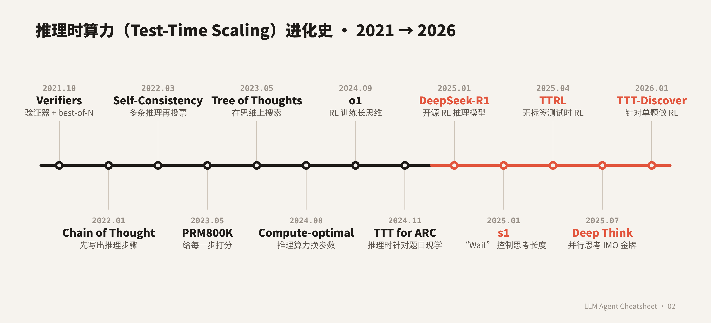

# LLM Agent 速查表 · 02：Test-Time Scaling 进化史（2019 → 2026）

[English](README.md) | **中文**

> 训练完的模型，推理时多花算力能不能变得更聪明？这一期从"多采几次挑一个"讲到"推理时现学"。每个阶段先说**当时卡在什么问题上**，再看**哪些论文解决了它**，最后看**又带来了什么新问题**。

📄 **4 页速查表（PDF）：** [cheatsheet_zh.pdf](cheatsheet_zh.pdf)——公式、算法、关键数字、自测题。

## 一句话总结

**多采样 + 验证器 → 思维链（多写几步）→ 自一致性（投票）→ 过程奖励（给每一步打分）→ 树搜索与自我修正 → 推理算力的 scaling law → 用 RL 把长思维训练进模型（o1、R1）→ 控制思考长度 → 潜空间思考 → 测试时训练（推理时更新参数）→ 自适应思考与并行思考**

## 先分清：推理时的算力能花在哪

| 方式 | 怎么花算力 | 代表 | 需要什么 |
|---|---|---|---|
| **并行** | 独立采 N 个，再聚合 | best-of-N、自一致性、并行思考（Deep Think） | 聚合方法：投票、验证器、置信度 |
| **串行** | 一条推理写得更长，或反复修改 | 思维链、Self-Refine、o1 / R1 长思维、s1 的 "Wait" | 会自我纠错的模型 |
| **搜索** | 在中间步骤上展开、打分、剪枝 | Tree of Thoughts、PRM 引导的 beam search、MCTS | 能给中间步骤打分的验证器 |
| **潜空间** | 循环更多层，不多写 token | Coconut、Recurrent Depth | 专门训练的架构 |
| **更新参数** | 在测试样本上训练 | TTT、TTT for ARC、TTRL | 自监督信号或伪标签 |

这一期的阶段 1–6 主要是**外挂**在模型外面的方法；阶段 7 以后，这些能力逐渐被**训练进模型本身**。

## 目录

| 阶段 | 年份 | 回答的问题 |
|---|---|---|
| [0. 前史](#阶段-0--前史用搜索换算力20192021) | 2019–2021 | 推理时多花算力，能换来更好的结果吗？ |
| [1. 多采样 + 验证器](#阶段-1--多采几个再挑一个20212022) | 2021–2022 | 采样很多个答案，怎么挑出对的？ |
| [2. 思维链](#阶段-2--让模型多写几步2022) | 2022 | 模型能不能先写出中间步骤？ |
| [3. 自一致性](#阶段-3--自一致性采样多条推理再投票20222024) | 2022–2024 | 没有验证器时，怎么利用多次采样？ |
| [4. 过程奖励](#阶段-4--过程奖励给每一步打分20222024) | 2022–2024 | 怎么发现中间哪一步错了？ |
| [5. 搜索与修正](#阶段-5--树搜索与自我修正2023) | 2023 | 能不能在生成过程中探索、回退、修改？ |
| [6. Scaling law](#阶段-6--推理算力的-scaling-law2024) | 2024 | 推理算力值多少？和参数量怎么换？ |
| [7. 长思维 RL](#阶段-7--把搜索训练进模型长思维链2024-09--2025-01) | 2024–2025 | 能不能直接训练模型想得更久、更好？ |
| [8. 控制长度](#阶段-8--控制思考长度预算过度思考与思考不足2024-12--2025) | 2024–2025 | 怎么控制想多久？ |
| [9. 潜空间](#阶段-9--在潜空间里思考2024-12--2025) | 2024–2025 | 思考必须写成文字吗？ |
| [10. 测试时训练](#阶段-10--测试时训练推理时更新参数2019--2025) | 2019–2025 | 推理时能不能针对这道题现学？ |
| [11. 2025–2026](#阶段-11--20252026思考成了产品旋钮并行思考成了顶配) | 2025–2026 | 思考变成产品旋钮，并行思考成为顶配 |
| [12. 局限与争议](#阶段-12--局限与争议20252026) | 2025–2026 | 多想一定更好吗？ |

---

## 阶段 0 · 前史：用搜索换算力（2019–2021）

**问题：** 模型训练完就固定了。推理时多花算力，能不能换来更好的结果？

| 论文 | 首发 | 机构 | 做了什么 |
|---|---|---|---|
| [Scaling Scaling Laws with Board Games](https://arxiv.org/abs/2104.03113) | 2021-04 | 独立研究者（Andy L. Jones） | 在 Hex 棋上用 AlphaZero 量化"训练算力"和"推理时搜索算力"的交换关系：**训练算力每多 10 倍，大约可以省掉 15 倍的推理搜索算力**。这是"推理算力也有 scaling law"最早的清晰表述之一。 |

**变化：** 在棋类里，"推理时搜索"和"训练更大的模型"可以互相替代。**还缺什么：** 语言模型没有现成的搜索树，也没有可靠的打分函数。

## 阶段 1 · 多采几个，再挑一个（2021–2022）

**问题：** 一次生成经常出错。如果采样很多个答案，怎么挑出对的那个？

| 论文 | 首发 | 机构 | 做了什么 |
|---|---|---|---|
| [Training Verifiers to Solve Math Word Problems](https://arxiv.org/abs/2110.14168) | 2021-10 | OpenAI | 发布 GSM8K（8.5K 道小学数学题）。训练一个**验证器（verifier）**给答案打分，每题采样 100 个解，挑分最高的。**6B 模型 + 验证器略胜微调过的 175B 模型**，相当于把模型放大约 30 倍的效果。 |
| [AlphaCode](https://arxiv.org/abs/2203.07814) | 2022-02 | DeepMind | 每道竞赛题采样**上百万**个程序，用题目给的样例测试过滤掉约 99%，再按行为聚类，最多提交 10 个。在 5,000 人以上的 Codeforces 比赛中排名前 54.3%。 |

**变化：** "best-of-N + 验证器"成为最基本的推理时 scaling 方法。**代价：** 要单独训练验证器；采样数量很大。

## 阶段 2 · 让模型多写几步（2022）

**问题：** 直接给答案太难，模型能不能先把中间步骤写出来？

| 论文 | 首发 | 机构 | 做了什么 |
|---|---|---|---|
| [Chain-of-Thought Prompting](https://arxiv.org/abs/2201.11903) | 2022-01 | Google Research | 在少样本示例里写出推理过程。PaLM 540B 在 GSM8K 上从 17.9% 提到 **56.9%**。 |
| [Large Language Models are Zero-Shot Reasoners](https://arxiv.org/abs/2205.11916) | 2022-05 | 东京大学 | 只加一句 "Let's think step by step"。MultiArith 17.7% → 78.7%，GSM8K 10.4% → 40.7%（text-davinci-002）。 |

**变化：** 生成更多 token = 花更多推理算力，这是"串行"方向的起点。**还缺什么：** 一条推理链错了就全错。

## 阶段 3 · 自一致性：采样多条推理再投票（2022–2024）

**问题：** 一条思维链不可靠，没有验证器的时候怎么办？

| 论文 | 首发 | 机构 | 做了什么 |
|---|---|---|---|
| [Self-Consistency](https://arxiv.org/abs/2203.11171) | 2022-03 | Google Research | 采样多条推理路径（论文用 40 条），对**最终答案多数投票**。不需要训练任何东西。GSM8K +17.9%、SVAMP +11.0%、AQuA +12.2%、StrategyQA +6.4%、ARC-c +3.9%。 |
| [Universal Self-Consistency](https://arxiv.org/abs/2311.17311) | 2023-11 | Google | 答案没法精确比对（摘要、开放问答）时，把所有候选拼在一起，让模型自己挑"最一致"的那个。 |
| [Are More LLM Calls All You Need?](https://arxiv.org/abs/2403.02419) | 2024-03 | Stanford | 发现投票的效果随调用次数**先升后降**：多采样对简单题有帮助，对难题反而有害。 |

**变化：** 自一致性就是最简单的**并行** test-time scaling：用 N 倍算力换准确率，不需要验证器。**还缺什么：** 投票只看最终答案，没法判断中间哪一步错了；而且会饱和。

## 阶段 4 · 过程奖励：给每一步打分（2022–2024）

**问题：** 答案对了，过程可能是错的；投票和结果奖励都发现不了。

| 论文 | 首发 | 机构 | 做了什么 |
|---|---|---|---|
| [Process- and Outcome-based Feedback](https://arxiv.org/abs/2211.14275) | 2022-11 | DeepMind | 在 GSM8K 上比较只看结果和逐步监督。最终答案错误率接近，但在答案正确的解里，**推理过程出错的比例从 14.0% 降到 3.4%**。 |
| [Let's Verify Step by Step](https://arxiv.org/abs/2305.20050) | 2023-05 | OpenAI | 人工标注 **80 万个步骤级标签（PRM800K）**，训练过程奖励模型（PRM）。从 1,860 个候选里挑，在 MATH 子集上解出 **78.2%**，高于结果奖励模型（72.4%）和多数投票（69.6%）。 |
| [Math-Shepherd](https://arxiv.org/abs/2312.08935) | 2023-12 | 北京大学 | 不用人工标注：从每一步往后采样 8 个续写，看能否到达正确答案，以此**自动生成步骤标签**。 |
| [Rewarding Progress (PAV)](https://arxiv.org/abs/2410.08146) | 2024-10 | CMU / Google Research | 把一步的价值定义为它带来的"**进步**"（做这一步前后，答对概率的变化）。比结果奖励模型准确率高 8% 以上，计算效率高 1.5–5 倍。 |

**变化：** 有了能给中间步骤打分的验证器，才能在推理过程中做**搜索**。**代价：** 人工标注很贵；PRM 本身也会被"钻空子"。

## 阶段 5 · 树搜索与自我修正（2023）

**问题：** 投票和 best-of-N 都是生成完再挑。能不能在生成过程中就探索、回退、修改？

| 论文 | 首发 | 机构 | 做了什么 |
|---|---|---|---|
| [Self-Refine](https://arxiv.org/abs/2303.17651) | 2023-03 | CMU | 同一个模型轮流做三件事：生成、给自己提意见、修改，不需要训练。7 个任务上平均提升约 20%（绝对值）。 |
| [Tree of Thoughts](https://arxiv.org/abs/2305.10601) | 2023-05 | Princeton / Google DeepMind | 把推理拆成"思维"节点，让模型自己评估每个节点，用 BFS / DFS 搜索、可以回退。24 点游戏上 GPT-4 + CoT 只有 4%，ToT 达到 **74%**。 |
| [RAP](https://arxiv.org/abs/2305.14992) | 2023-05 | UC San Diego | 同一个大模型既当 agent 又当"世界模型"，用 **MCTS** 搜索。在 Blocksworld 规划上，LLaMA-33B 比 GPT-4 + CoT 相对提升 33%。 |
| [Graph of Thoughts](https://arxiv.org/abs/2308.09687) | 2023-08 | ETH Zurich | 思维可以合并、循环，组成图。排序任务上质量比 ToT 高 62%，成本低 31% 以上。 |

**变化：** 推理时可以做**搜索**和**串行修改**了。**代价：** 每道题要调用模型很多次；"自己评估自己"往往不可靠。

## 阶段 6 · 推理算力的 scaling law（2024）

**问题：** 推理时多花的算力，到底值多少？是该花在推理上，还是用来训练更大的模型？

| 论文 | 首发 | 机构 | 做了什么 |
|---|---|---|---|
| [Large Language Monkeys](https://arxiv.org/abs/2407.21787) | 2024-07 | Stanford / Oxford | 覆盖率（N 次采样中至少一次答对）随采样数在 4 个数量级内**近似对数线性增长**。SWE-bench Lite：DeepSeek-Coder-V2 采 1 次 15.9%，采 250 次 **56%**（当时单次采样最好成绩 43%）。但多数投票和奖励模型在几百个样本后就**饱和**了。 |
| [Scaling LLM Test-Time Compute Optimally](https://arxiv.org/abs/2408.03314) | 2024-08 | UC Berkeley / Google DeepMind | 两种花推理算力的方式：**对 PRM 做搜索**，和**让模型逐步修改自己的答案**。按题目难度选最优策略（"compute-optimal"），效率比 best-of-N 高 **4 倍以上**。在算力相同的条件下，小模型 + 推理算力能胜过**大 14 倍**的模型，但仅限于小模型本来就有一定成功率的题；最难的题上，加预训练更划算。 |
| [Inference Scaling Laws](https://arxiv.org/abs/2408.00724) | 2024-08 | 清华 / CMU | 证明加权多数投票会随样本数饱和；提出 REBASE 树搜索，让 Llemma-7B 胜过 Llemma-34B，算力约少一半。 |
| [Generative Verifiers (GenRM)](https://arxiv.org/abs/2408.15240) | 2024-08 | Google DeepMind / Toronto | 把验证变成生成：让验证器先写推理，再输出 "Yes" 的概率作为分数；可以对多条验证推理取平均（验证本身也能 scaling）。GSM8K best-of-N 从 73% 提到 93.4%。 |

**变化：** test-time compute 第一次被当成一个可以**和参数量做交换**的资源，有了清晰的 scaling 曲线。**还缺什么：** 这些方法都是"外挂"在模型外面的，模型本身并不会更好地思考。

## 阶段 7 · 把搜索训练进模型：长思维链（2024-09 → 2025-01）

**问题：** 能不能直接训练模型自己"想得更久、想得更好"，而不是在外面套搜索？

| 论文 / 发布 | 首发 | 机构 | 做了什么 |
|---|---|---|---|
| [Learning to Reason with LLMs (o1)](https://openai.com/index/learning-to-reason-with-llms/) | 2024-09 | OpenAI | 用大规模强化学习训练模型生成很长的内部思维链。性能**同时随训练算力（RL）和推理算力（思考时间）提升**。AIME 2024：GPT-4o 12%，o1 单次 74%，64 次投票 83%，1,000 个样本用打分模型重排 93%。 |
| [DeepSeek-R1](https://arxiv.org/abs/2501.12948) | 2025-01 | DeepSeek | **R1-Zero** 只用规则奖励 + GRPO 强化学习（不经 SFT），AIME 2024 从 15.6% 涨到 71.0%（多数投票 86.7%），训练中出现自我反思的"**aha moment**"，回答也越来越长。R1 达到 79.8%。开源权重和蒸馏小模型。 |
| [Kimi k1.5](https://arxiv.org/abs/2501.12599) | 2025-01 | Moonshot AI | 把 RL 的上下文扩到 128k，不用 MCTS、价值函数或 PRM。AIME 77.5%。还提出 **long2short**：把长思维的能力迁移到短回答。 |

**变化：** test-time scaling 从"外部算法"变成了**模型自身的能力**：思考越长越准，而且这种能力可以用 RL 训练出来。**新问题：** 想太多、想太少，以及怎么控制思考的长度。

## 阶段 8 · 控制思考长度：预算、过度思考与思考不足（2024-12 → 2025）

**问题：** 长思维链很贵，简单题也会想很久；难题上又可能还没想完就换思路。

| 论文 / 发布 | 首发 | 机构 | 做了什么 |
|---|---|---|---|
| [Do NOT Think That Much for 2+3=?](https://arxiv.org/abs/2412.21187) | 2024-12 | 腾讯 AI Lab / 上海交大 | 系统研究**过度思考**：在 2+3 这种题上，类 o1 模型用的 token 比普通模型多 1,953%。提出的训练方法在 MATH500 上把 QwQ-32B 的 token 减少约 48.6%，准确率基本不变。 |
| [Thoughts Are All Over the Place](https://arxiv.org/abs/2501.18585) | 2025-01 | 腾讯 AI Lab | 研究**思考不足**：答错时模型频繁换思路，切换比答对时多 418%。提出 TIP 解码，惩罚过早切换。 |
| [s1: Simple Test-Time Scaling](https://arxiv.org/abs/2501.19393) | 2025-01 | Stanford | 只用 **1,000 条**精选数据微调 Qwen2.5-32B-Instruct（16 张 H100 训练 26 分钟）。**Budget forcing**：想停的时候强行追加 "Wait" 让模型继续想，或者到预算就截断。AIME24 从 50.0% 提到 56.7%；竞赛数学上比 o1-preview 最多高 27%。 |
| [L1 (LCPO)](https://arxiv.org/abs/2503.04697) | 2025-03 | CMU | 用 RL 训练模型**遵守提示里给定的思考长度**；在同样长度下，1.5B 模型胜过 GPT-4o。 |

**变化：** 思考长度成了一个**可以调的旋钮**（产品里的"思考预算"、"推理强度"都是这个旋钮）。**还缺什么：** 思考都写成 token，又长又慢。

## 阶段 9 · 在潜空间里思考（2024-12 → 2025）

**问题：** 必须把每一步思考都写成文字吗？

| 论文 | 首发 | 机构 | 做了什么 |
|---|---|---|---|
| [Coconut](https://arxiv.org/abs/2412.06769) | 2024-12 | Meta FAIR | 把最后一层隐藏状态直接当成下一步的输入，在**连续空间**里推理，可以同时保留多条可能路径（类似 BFS）。需要规划回溯的 ProsQA 上 97.0%（CoT 77.5%）；GSM8K 上不如 CoT（34.1% vs 42.9%）。 |
| [Recurrent Depth](https://arxiv.org/abs/2502.05171) | 2025-02 | ELLIS / 马普所 Tübingen | 3.5B 模型，中间一块可以**循环任意多次**。推理时循环越多，计算量越大（最多相当于 50B 参数模型的计算量），不需要输出更多 token。 |

**变化：** 推理算力可以花在"层数"上，而不只是"token 数"上。**代价：** 推理过程不可读，更难检查和监督。

## 阶段 10 · 测试时训练：推理时更新参数（2019 → 2025）

**问题：** 前面的方法都不改权重。遇到分布外的新题，能不能在推理时**针对这道题学一下**？

| 论文 | 首发 | 机构 | 做了什么 |
|---|---|---|---|
| [Test-Time Training (TTT)](https://arxiv.org/abs/1909.13231) | 2019-09 | UC Berkeley | 分布偏移时，在每个测试样本上用**自监督任务（预测图片旋转角度）**更新共享编码器再预测。ImageNet-C 高斯噪声下准确率大幅提升。 |
| [TENT](https://arxiv.org/abs/2006.10726) | 2020-06 | UC Berkeley | 测试时**最小化预测熵**，只更新 BatchNorm 的统计量和仿射参数。ImageNet-C 错误率 59.5% → 44.0%。 |
| [TTT Layers](https://arxiv.org/abs/2407.04620) | 2024-07 | Stanford | 把 RNN 的隐藏状态本身做成一个**小模型**，每读一个 token 就做一步自监督梯度更新（TTT-Linear / TTT-MLP）。上下文超过 16k 后 Mamba 不再变好，TTT 仍在降低困惑度。 |
| [Titans](https://arxiv.org/abs/2501.00663) | 2024-12 | Google Research | **神经长期记忆**在推理时学习：用"惊讶度"（关联记忆损失的梯度）决定记什么，带动量和遗忘门；上下文可超过 200 万。 |
| [The Surprising Effectiveness of TTT](https://arxiv.org/abs/2411.07279) | 2024-11 | MIT | 在 ARC 上，对每道题用它的示例（留一法 + 几何变换增强）训练一个 **LoRA**，再分变换投票。8B 模型达到 53%；和程序合成集成后 61.9%，与人类平均水平相当。 |
| [TTRL: Test-Time Reinforcement Learning](https://arxiv.org/abs/2504.16084) | 2025-04 | 清华 | 在**没有标签**的测试题上做 RL：用多数投票的答案当伪标签，给出 0/1 奖励。Qwen2.5-Math-7B 在 AIME 2024 上 pass@1 提升约 211%，训练后的单次准确率甚至超过训练前的多数投票。 |

**变化：** 推理时不只可以"多想"，还可以"**现学**"。test-time scaling 和持续学习、自我进化开始合流。**代价：** 每道题都要做一次训练，成本和稳定性都是问题。

## 阶段 11 · 2025–2026：思考成了产品旋钮，并行思考成了顶配

### 11a. 从"思考预算"到"推理强度"再到"自适应思考"

**问题：** 长思维模型上线后，用户和开发者需要控制它想多久。

| 发布 | 时间 | 机构 | 怎么控制推理算力 |
|---|---|---|---|
| [Claude 3.7 Sonnet](https://www.anthropic.com/news/claude-3-7-sonnet) | 2025-02 | Anthropic | 同一个模型可切换普通 / 扩展思考，API 可设**思考 token 预算**（最高 128K）。[配套研究](https://www.anthropic.com/research/visible-extended-thinking)同时展示了串行（思考越长越准，近似对数线性）和并行（256 个样本 + 打分模型，GPQA 84.8%）两种 scaling。 |
| [o3 / o4-mini](https://openai.com/index/introducing-o3-and-o4-mini/) | 2025-04 | OpenAI | 用 RL 训练模型在思考中**决定何时用工具**；RL 训练和推理算力又各扩了一个数量级。o4-mini 用 Python 时 AIME 2025 单次 99.5%。 |
| [Gemini 2.5 Flash](https://developers.googleblog.com/en/start-building-with-gemini-25-flash/) | 2025-04 | Google | 思考可开可关，预算 0–24,576 token。 |
| [Qwen3](https://arxiv.org/abs/2505.09388) | 2025-05 | 阿里 Qwen | 思考 / 不思考两种模式合在一个模型里，并有思考预算机制。（7 月的 2507 版又拆回了两个独立模型。） |
| [gpt-oss](https://openai.com/index/introducing-gpt-oss/) | 2025-08 | OpenAI | 开源权重；系统提示里一句话设定 low / medium / high 三档推理强度。 |
| [GPT-5](https://openai.com/index/introducing-gpt-5/) | 2025-08 | OpenAI | **实时路由器**决定用快速模型还是 "GPT-5 thinking"；GPT-5 pro 使用并行 test-time compute。比 o3 少用 50–80% 输出 token 而效果更好。 |
| [GPT-5.1](https://openai.com/index/gpt-5-1-for-developers/) | 2025-11 | OpenAI | **自适应推理**：按题目难度动态调整思考时间；新增 `reasoning_effort='none'`。 |
| [Claude Opus 4.5](https://www.anthropic.com/news/claude-opus-4-5) | 2025-11 | Anthropic | `effort` 参数；中等强度下达到 Sonnet 4.5 的最好 SWE-bench 成绩，输出 token 少 76%。 |
| [Claude Opus 4.6](https://www.anthropic.com/news/claude-opus-4-6) | 2026-02 | Anthropic | **自适应思考**：模型自己判断何时需要深入推理；四档强度 low / medium / high / max。 |
| [GPT-5.2](https://openai.com/index/introducing-gpt-5-2/) · [Opus 4.7](https://www.anthropic.com/news/claude-opus-4-7) | 2025-12 · 2026-04 | OpenAI · Anthropic | 两家都新增了 **xhigh** 档。 |

**变化：** 推理算力从研究里的"N 和步数"变成了 API 参数：token 预算 → 强度档位 → 模型自己决定。

### 11b. 并行思考：从"事后投票"到"训练出来的并行"

**问题：** 一条长思维链会"钻牛角尖"。能不能同时探索多条路，再合并？

| 论文 / 发布 | 时间 | 机构 | 做了什么 |
|---|---|---|---|
| [Sample, Scrutinize and Scale](https://arxiv.org/abs/2502.01839) | 2025-02 | Google | 只用随机采样 + 自我验证。发现"**隐式 scaling**"：样本越多，验证反而越准。让 Gemini 1.5 Pro 超过 o1-preview。 |
| [Self-Certainty](https://arxiv.org/abs/2502.18581) | 2025-02 | UC Berkeley | 不用奖励模型，用模型对自己输出的**置信度**从 N 个样本里挑。 |
| [Adaptive Parallel Reasoning](https://arxiv.org/abs/2504.15466) | 2025-04 | UC Berkeley | 模型学会自己调用 `spawn()` / `join()` 开子线程，端到端 RL 训练。Countdown 上 83.4% vs 60.0%（同为 4k 上下文）。 |
| [Claude 4](https://www.anthropic.com/news/claude-4) | 2025-05 | Anthropic | SWE-bench 并行采样多个补丁，去掉破坏现有测试的，再用内部打分模型选一个：Opus 4 从 72.5% 到 79.4%。 |
| [Gemini Deep Think 获 IMO 金牌](https://deepmind.google/blog/advanced-version-of-gemini-with-deep-think-officially-achieves-gold-medal-standard-at-the-international-mathematical-olympiad/) | 2025-07 | Google DeepMind | **并行思考**：同时探索并合并多种解法，全程自然语言、不用工具。IMO 2025 解出 5/6 题，35/42 分，官方评分金牌。同期 OpenAI 的实验模型也拿到 35/42。 |
| [DeepConf](https://arxiv.org/abs/2508.15260) | 2025-08 | Meta AI / UCSD | 生成中或生成后按**置信度**过滤低质量推理链，无需训练。AIME 2025 最高 99.9%，生成 token 最多减少 84.7%。 |
| [ParaThinker](https://arxiv.org/abs/2509.04475) | 2025-08 | 清华 | **原生并行思考**：训练模型同时生成多条路径再融合，避免"隧道视野"。8 条路径时 1.5B / 7B 分别 +12.3% / +7.5%，延迟只多 7.1%。 |
| [DeepSeekMath-V2](https://arxiv.org/abs/2511.22570) | 2025-11 | DeepSeek | 训练一个证明**验证器**当奖励，再扩大验证算力来标注难题。加大推理算力后 Putnam 2024 得 118/120。 |
| [Gemini 3 Deep Think](https://blog.google/products/gemini/gemini-3-deep-think/) | 2025-12 | Google | 并行推理同时探索多个假设。ARC-AGI-2 45.1%；2026-02 [升级版](https://blog.google/innovation-and-ai/models-and-research/gemini-models/gemini-3-deep-think/)达到 84.6%。 |
| [PaCoRe](https://arxiv.org/abs/2601.05593) | 2026-01 | — | 多轮并行：每轮的多条轨迹压缩成消息喂给下一轮，结果奖励 RL 训练。8B 模型 HMMT 2025 达 94.5%（GPT-5 为 93.2%），约用 200 万 token。 |

**变化：** 并行 scaling 从"采样后投票"进化到"模型自己学会分叉与合并"，成为各家最贵的推理档位（Deep Think、GPT-5 pro）。

### 11c. 高效推理：该想的时候才想

| 论文 | 时间 | 机构 | 做了什么 |
|---|---|---|---|
| [Stop Overthinking（综述）](https://arxiv.org/abs/2503.16419) | 2025-03 | Rice | 把高效推理方法分成三类：改模型、改推理输出、改输入提示。 |
| [NoThinking](https://arxiv.org/abs/2504.09858) | 2025-04 | UC Berkeley / AI2 | 用提示跳过思考，再配合并行 best-of-N。700 token 预算下 ACM 23 上 51.3 vs 28.9。 |
| [DEER](https://arxiv.org/abs/2504.15895) | 2025-04 | — | 在"换思路"的位置试着先给答案，置信度够高就提前结束；思维链缩短 19.1%–80.1%，准确率还略升。 |
| [AdaptThink](https://arxiv.org/abs/2505.13417) | 2025-05 | 清华 | 用 RL 让模型对每道题选择思考或不思考；长度减少 53%，准确率 +2.4%。 |
| [Don't Overthink It (short-m@k)](https://arxiv.org/abs/2505.17813) | 2025-05 | Meta FAIR / 希伯来大学 | 并行跑 k 条，最先结束的 m 条投票。比最长的那条准确率最多高 34.5%，耗时最多少 33%：**短的推理链往往更准**。 |

### 11d. 验证器也在 scaling

| 论文 | 时间 | 机构 | 做了什么 |
|---|---|---|---|
| [DeepSeek-GRM](https://arxiv.org/abs/2504.02495) | 2025-04 | DeepSeek / 清华 | 生成式奖励模型先写评分原则和点评再打分；推理时并行采样多次、用 meta-RM 引导投票。推理时 scaling 奖励模型比训练时 scaling 更划算。 |
| [ThinkPRM](https://arxiv.org/abs/2504.16828) | 2025-04 | 密歇根大学 / Mila / LG | 用长思维链做逐步验证的生成式 PRM，只用 PRM800K 1% 的标签就超过判别式 PRM。 |
| [J1](https://arxiv.org/abs/2505.10320) | 2025-05 | Meta FAIR | 用 RL 训练"会思考的评委"，把评判变成可验证任务。 |

### 11e. 测试时训练的新进展

| 论文 / 发布 | 时间 | 机构 | 做了什么 |
|---|---|---|---|
| [One-Minute Video Generation with TTT](https://arxiv.org/abs/2504.05298) | 2025-04 | NVIDIA / Stanford / UCSD | 在预训练视频模型里加入 TTT 层，生成一分钟连贯视频；人工评测领先 34 Elo。 |
| [AlphaEvolve](https://deepmind.google/discover/blog/alphaevolve-a-gemini-powered-coding-agent-for-designing-advanced-algorithms/) | 2025-05 | Google DeepMind | **进化式推理时搜索**：Gemini 提出代码，自动评测打分，循环迭代。找到用 48 次标量乘法的 4×4 复数矩阵乘法；为 Google 平均回收 0.7% 的全球算力。 |
| [Intuitor (RLIF)](https://arxiv.org/abs/2505.19590) | 2025-05 | UC Berkeley | 只用模型自己的置信度当 GRPO 奖励，不要标签和验证器，数学上追平用标准答案的 GRPO。 |
| [SEAL](https://arxiv.org/abs/2506.10943) | 2025-06 | MIT | 模型自己写"**自我编辑**"（训练数据 + 超参数），用 SFT 更新自己；用 RL 学会写有用的自我编辑。 |
| [TRM](https://arxiv.org/abs/2510.04871) | 2025-10 | Samsung SAIL Montréal | 只有 2 层、7M 参数的网络**递归**调用自己；ARC-AGI-1 45%、ARC-AGI-2 8%。 |
| [Nested Learning / Hope](https://research.google/blog/introducing-nested-learning-a-new-ml-paradigm-for-continual-learning/) | 2025-11 | Google Research | 把模型看成多层嵌套的优化过程；Hope 是能自我修改的 Titans 变体，面向持续学习。 |
| [ARC Prize 2025 总结](https://arcprize.org/blog/arc-prize-2025-results-analysis) | 2025-12 | ARC Prize 基金会 | 年度主题是"**精炼循环**（refinement loops）"："所有关键的针对任务的训练都发生在测试时。" |
| [TTT-E2E](https://arxiv.org/abs/2512.23675) | 2025-12 | Stanford / NVIDIA | 滑窗 Transformer 在推理时继续对上下文做下一个 token 预测训练，初始化用元学习得到。128K 上下文时比全注意力快 2.7 倍。 |
| [TTT-Discover](https://arxiv.org/abs/2601.16175) | 2026-01 | Stanford / NVIDIA | 推理时**针对单个问题做 RL**（AlphaEvolve 的模型是冻结的）。GPU kernel 比已有最好结果快最多 2 倍，每题几百美元。 |

### 11f. Agent 的 test-time scaling：多想，还是多做？

| 论文 / 发布 | 时间 | 机构 | 做了什么 |
|---|---|---|---|
| [BrowseComp](https://openai.com/index/browsecomp/) | 2025-04 | OpenAI | 1,266 道难找、易验证的浏览题。Deep Research 51.5%，表现**随推理算力平滑上升**；best-of-N 再 +15–25%。 |
| [Thinking vs. Doing (TTI)](https://arxiv.org/abs/2506.07976) | 2025-06 | CMU | 不扩展思考 token，而是扩展**与环境交互的步数**，用课程式在线 RL 训练网页 agent。 |
| [Scaling TTC for LLM Agents](https://arxiv.org/abs/2506.12928) | 2025-06 | — | 系统比较 agent 的并行采样、串行修改、验证与合并：知道**何时反思**很重要，列表式选择效果最好。 |
| [Kimi K2 Thinking](https://www.kimi.com/blog/kimi-k2-thinking) | 2025-11 | Moonshot AI | 同时 scaling 思考 token 和**工具调用步数**，可连续调用 200–300 次工具。BrowseComp 60.2%。 |
| [Recursive Language Models](https://arxiv.org/abs/2512.24601) | 2025-12 | MIT | 把超长输入存成环境变量，模型写代码查看并**递归调用自己**处理。 |

## 阶段 12 · 局限与争议（2025–2026）

**问题：** 多想一定更好吗？RL 真的教会了模型新东西吗？思维链说的是真话吗？

| 论文 | 时间 | 机构 | 结论 |
|---|---|---|---|
| [Reasoning Models Don't Always Say What They Think](https://www.anthropic.com/research/reasoning-models-dont-say-think) | 2025-04 | Anthropic | 在题目里塞提示，模型用了提示却很少在思维链里承认：Claude 3.7 Sonnet 只有 25%、DeepSeek R1 39% 的时候提到。 |
| [Does RL Really Incentivize Reasoning?](https://arxiv.org/abs/2504.13837) | 2025-04 | 清华 | k 很大时，**基座模型的 pass@k 反而高于** RL 模型：RL 主要提高采样效率，未必扩展能力边界。 |
| [ProRL](https://arxiv.org/abs/2505.24864) | 2025-05 | NVIDIA | 反方：足够长的 RL（KL 控制 + 定期重置参考策略 + 多样任务）能让 RL 模型在各种 k 下都超过基座。 |
| [Spurious Rewards](https://arxiv.org/abs/2506.10947) | 2025-06 | UW / AI2 | 在 Qwen2.5-Math-7B 上用**随机奖励**做 RL，MATH-500 也能 +21.4 个点（真实奖励 +29.1）；换成 Llama / OLMo 就不行。说明 RL 常常只是放大了模型已有的行为。 |
| [The Illusion of Thinking](https://arxiv.org/abs/2506.06941) | 2025-06 | Apple | 用难度可控的谜题（汉诺塔、过河等）：超过某个复杂度后**准确率崩到零**，而且思考 token 先增后减。 |
| [The Illusion of the Illusion of Thinking](https://arxiv.org/abs/2506.09250) | 2025-06 | A. Lawsen | 反驳：很多"失败"是输出长度上限造成的，部分过河题本身无解；让模型输出生成函数而不是完整步骤，准确率就恢复了。 |
| [Inverse Scaling in Test-Time Compute](https://arxiv.org/abs/2507.14417) | 2025-07 | Anthropic Fellows 等 | 在有干扰信息、虚假特征等任务上，**推理越长效果越差**。 |
| [CoT Monitorability](https://arxiv.org/abs/2507.11473) | 2025-07 | 多家实验室联合 | 立场文章：思维链是监控模型的难得窗口，开发决策要考虑别破坏它的"可监控性"。 |
| [Is CoT Reasoning a Mirage?](https://arxiv.org/abs/2508.01191) | 2025-08 | 亚利桑那州立大学 | 从头训练小模型做受控实验：分布外时，思维链推理是"脆弱的海市蜃楼"。 |

**目前的共识（作者整理）：** 推理算力确实能换来准确率，但收益取决于题目难度、验证器质量和基座模型已有的能力；"想得更长"不等于"想得更对"。

## 入门必读 6 篇

如果只读 6 篇，建议按这个顺序：

1. [Self-Consistency](https://arxiv.org/abs/2203.11171)：最简单的并行 scaling，不用训练任何东西
2. [Let's Verify Step by Step](https://arxiv.org/abs/2305.20050)：过程奖励为什么比结果奖励好
3. [Scaling LLM Test-Time Compute Optimally](https://arxiv.org/abs/2408.03314)：推理算力和参数量怎么交换
4. [DeepSeek-R1](https://arxiv.org/abs/2501.12948)：只用 RL 训练出长思维
5. [s1](https://arxiv.org/abs/2501.19393)：1,000 条数据 + 一个 "Wait" 就能控制思考长度
6. [The Surprising Effectiveness of Test-Time Training](https://arxiv.org/abs/2411.07279)：推理时针对每道题现学

## 延伸阅读：综述

- [What, How, Where, and How Well? A Survey on Test-Time Scaling in LLMs](https://arxiv.org/abs/2503.24235)（2025-03）：按"扩展什么、怎么扩展、在哪扩展、效果如何"四个维度整理
- [From System 1 to System 2: A Survey of Reasoning LLMs](https://arxiv.org/abs/2502.17419)（2025-02）
- [Stop Overthinking: A Survey on Efficient Reasoning](https://arxiv.org/abs/2503.16419)（2025-03）
- [Trust but Verify: A Survey on Verification for Test-Time Scaling](https://arxiv.org/abs/2508.16665)（2025-08）

## 说明

- **日期**是 arXiv v1 提交月份或官方发布日期。arXiv 编号的月份前缀有时比提交月份晚一个月（例如 AlphaCode 是 2203 编号，2022-02 提交）。
- 部分论文在 v1 之后改过标题或数字：TTT for ARC 现标题为 *…for Few-Shot Learning*；TTRL 的 211% 取自最新版本。
- **机构**为第一作者主要单位的简称；标"—"的是没能从原文核实的。
- 所有数字都对照过原文或官方页面（2026 年 10 月核对）。发现错误欢迎提 issue。

## 许可

[CC BY 4.0](../LICENSE)
