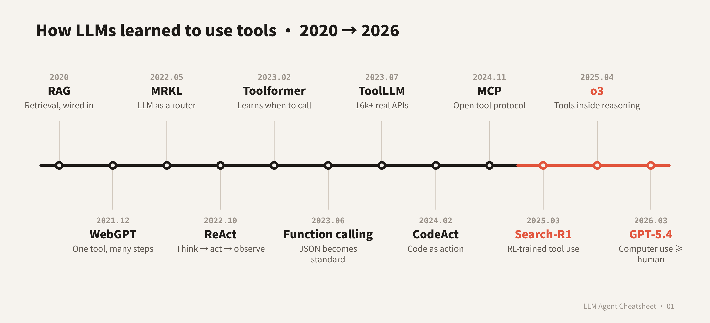

# LLM Agent Cheatsheet · AI Agent 论文速查表

**English** · Dense, source-linked cheatsheets on how LLM agents work. Each episode covers one topic as a chain of problem → method → new problem, with the formulas, formats and key numbers from the original papers, plus a printable PDF.

**中文** · 高浓缩的 LLM Agent 论文速查表。每一期讲清一个主题：按"遇到什么问题 → 谁用什么方法解决 → 又带来什么新问题"串起论文，写到公式、调用格式和关键数字，并附可打印的 PDF。所有说法都附原文链接。

## Episodes · 目录

| # | Topic | 主题 | Links |
|---|---|---|---|
| 01 | How LLMs learned to use tools (2015 → 2026) | 大模型是怎么学会用工具的 | [English](01-tool-calling-evolution/README.md) · [中文](01-tool-calling-evolution/README_zh.md) · [PDF](01-tool-calling-evolution/cheatsheet_zh.pdf) |
| 02 | The evolution of test-time scaling (2019 → 2026) | Test-Time Scaling 进化史：推理时怎么花算力 | [English](02-test-time-scaling/README.md) · [中文](02-test-time-scaling/README_zh.md) · [PDF](02-test-time-scaling/cheatsheet_zh.pdf) |

## Contributing · 参与贡献

Found an error or a missing paper? Open an issue or a pull request.
发现错误或遗漏？欢迎提 issue 或 pull request。

## License · 许可

[CC BY 4.0](https://creativecommons.org/licenses/by/4.0/)
